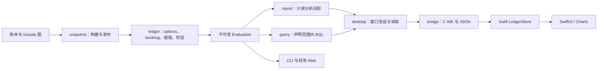

# Go 会计引擎与原生 macOS 账本分析设计

**当前实施基线（2026-10-01）**：Q02已实现有界查询执行、快照上下文、会话取消及真实C/Swift typed契约；完整工作台未完成。全量Go/七包race、51会计/147查询、原生三套/app及最新私人Swift/C通过（双方2833指令、零差异），见[本批证据](evidence/q02-bounded-execution-2026-10-01.md)。会计v3-core-3、默认legacy及查询contract保持；下一步按31.2接后台客户端、Store/QueryView、错误位置和导出。Q01剩余语义、X01/X02及GUI/安装/发行继续保留。

开发入口见[文档导航与当前差距](go-beancount-native-roadmap.md)。真实查询签名与尚未实现项见[查询能力矩阵](query-capability-matrix.md)。此前16个固定版本场景的[文档复验](evidence/go-native-design-refresh-2026-10-01.md)为历史证据，最新实现状态如下。

前批Q01已实现ParseStandard/EvaluateTyped、typed-json、Position/Amount/Inventory、来源/stack/pad metadata及动态/NULL/unary子集，91个查询场景和50个会计案例当时通过，见[历史证据](evidence/q01-dynamic-null-query-2026-10-01.md)。cast和复合转换的开工失败已修复，当前已验范围见30.5–30.6；剩余签名/精度/预设与原生工作台仍缺，Q01/Q02未完成。

本文规定目标行为；当前源码状态由progress管理。历史基线用于解释修正，实施时直接从手册第39节继续，不从旧失败样例重新开发。

初版：2026-09-30；基线更新：2026-10-01。状态：目标设计，部分核心能力已有实现。当前完成情况与证据见[实施进度](go-beancount-native-progress.md)；正文的目标行为不等于已验收。

本文定义下一轮开发的目标行为。配套文件：

- [开发计划与任务依赖](go-beancount-native-plan-2026-09-30.md)：决定先做什么、交付哪些里程碑。
- [实施步骤与验收手册](go-beancount-native-implementation-2026-09-30.md)：每个任务的修改位置、复现、检查和完成条件。
- [语义配置提案 ADR-0049](adr/0049-stage-accounting-corrections-with-explicit-semantics-profiles.md)：解决旧结果保护与 v3 修正之间的取舍。

阅读顺序为本文 → 计划 → 实施手册。三份文件共同构成下一轮开发基线；任务编号统一。已有 ADR 未被本次文档自动撤销，ADR-0049 已接受显式配置；默认切换和 legacy 撤除仍未决定。

## 1. 目标与交付范围

目标是独立、离线的 Go 会计引擎，加上可以日常使用的 SwiftUI macOS 账本分析工具。Beancount v3 决定兼容会计行为，AVERAGE 等扩展具有单独的契约；Fava 1.30.12 提供分析工作流参照。原生端采用 macOS 控件、材质和 Charts，按任务结果验收，不宣称浏览器像素等价。

| 里程碑 | 可交付能力 | 不由此推断的能力 |
| --- | --- | --- |
| M1：可信核心 | 已发现的 booking、批次日期、容差问题修复；有显式语义切换与差分证据 | 完整 Beancount/Python 插件运行时 |
| M2：稳定只读版 | 多币种报表、趋势、流水、诊断、热重载、窗口生命周期及开发包可验收 | 完整 Fava 功能、已公证发布 |
| M3：投资分析版 | 账户详情、截至日持仓、成本/均价、可解释收益、价格历史 | 自动价格抓取、任意收益归因 |
| M4：查询与记录浏览版 | 声明范围内的 BQL、原生查询、全指令 Journal、附件与分析导出 | 完整 SQL、Python importer、原生编辑 |

本轮不安排原生编辑、快捷记账、自动导入、价格网络抓取、预算、规划界面、移动端或 Intel/universal。现有 Web 的 authoring、quickentry、planning 和方言能力继续保持；共享核心变化必须验证相关行为。上述后续能力可以另立计划，不能计入本轮已完成范围。

## 2. 当前基线与历史证据

代码基线是 HEAD `20a9a6e86a5b4e2d6bb51aa2d2ae19dcd2934ddd` 加上 2026-09-30 检查时已有的未提交修改，包括 `internal/desktop`、Swift Store 和原生测试。只检出 HEAD 会丢失已实现能力。开始实施必须保存实际工作区 diff 与文件清单；不得覆盖或丢弃这些修改。

### 当前开发判断

当前公开会计51/51及独立AVERAGE、查询147/147通过。当前私人同源Go/Python与真实Swift/C对照为47文件、双方2833指令、零分录及库存差异、支出73行/收入22行一致；native_checked/native_contract为true，三个截至日及48可用性检查通过。本批没有GUI或新typed查询私人对照，详见[本批证据](evidence/q01-date-aggregate-price-2026-10-01.md)。

仍缺查询有效元数据长尾、剩余声明签名及完整NULL/动态类型、原生查询、全指令与配置浏览、附件和分析导出。已有账户/持仓/价格页的GUI、全页键盘与辅助功能、独立安装循环、远端CI、旧系统及公开签名仍有未验项。核心修正通过显式v3使用，默认legacy没有迁移。以下2.1–2.3按历史记录保留，不能以旧计数或旧red覆盖这一判断。

### 2.1 2026-09-30 会话实测，供后续复验

外部个人账本只产生以下聚合摘要，没有作为 fixture 或 golden 入库：

- Beancount 3.2.3 / BeanQuery 0.2.0 与 OrangeCount 都没有账本诊断；均得到 2,830 条指令、2,498 笔交易，OrangeCount 中有 89 个账户。
- 99 个账户×币种余额一致；按月支出查询 72 行、收入查询 22 行一致。
- 上游有 311 个成本批次，OrangeCount 中这些批次都没有成本日期。忽略日期并按其余成本键聚合，数量一致；这只证明该聚合口径一致，不能证明批次身份一致。
- 14 笔交易的现有标准化表示有差异。临时检查在忽略分录顺序、价格符号并保留 12 位小数后消除了差异；这只是定位线索，不能成为新的兼容通过规则。价格符号、原始/已归约顺序及精度需由 V01 分别判定。
- 个人账本没有 AVERAGE 账户；它不能验收 AVERAGE。
- 真实 Swift/C 客户端能打开该账本，流水总数 2,498、首页 100 笔。默认目标币种下，两张报表和两类趋势为 `unavailable-currency`；选择 `native` 后两张报表分别返回 3 个与 2 个根节点。
- 原生探针的打开约 68–88 ms、单页读取约 1–6 ms，仅是同一机器上的少量客户端调用样本，不是 GUI 首帧或 p95。

合成账本已复现 G01–G05 的缺陷，详见实施手册的固定输入。常规测试通过不抵消这些失败。

本次会话已经执行并通过：`go test -count=1 ./...`；`go test -race -count=1 ./internal/ledger ./internal/report ./internal/snapshot ./internal/desktop ./internal/bridge`；`make mac-check`；`make fmt vet license`。`tools/parity` 对既有 18 个 golden fixture 只报告两项已登记的诊断行号差异。现有 AVERAGE fixture 仅买入，不含卖出。

### 2.2 继承证据与未验证项

[2026-09-27 原生记录](native-fava-equivalence-report.md)包含 GUI 查看、错误恢复、分页、双窗口和有界内存观察；本次没有重复完整 GUI 验收。拖入、大字体、精确最小窗口、GUI 性能、长期内存、另一目标机器、macOS 13 实机、远端 CI、Developer ID 和公证仍没有由本次检查补齐。

### 2.3 2026-10-01 当前工作区复验

2.1 为修正前证据。当前显式 v3 已实现 acquisition 日期、完整批次键、全局 booking、STRICT/SIZE/NONE、失败回滚、容差与 AVERAGE；默认仍为 legacy。

前批 `make parity-full` 为 schema 2、46/46 公开案例通过，AVERAGE 另用精确数学验证。当时 `make verify-private-ledger` 捕获 47 个文件，双方 2,830 条指令、0 错误；完整分录缺失/多出均为 0，库存差异账户为 0；月度支出 72 行、收入 22 行均一致。真实 C/Swift 原币成本根汇总、计数、分页与共享快照检查通过。该记录保留为历史证据，没有修改或提交个人账本。

这些证据不覆盖所有历史日期或未来分析页面。个人账本没有 AVERAGE，扩展仍用合成输入。N01 已修复报表默认折算缺价清空树，N02 已实现原币趋势、逐点估值与缺口；公开 fixture 的部分 GUI 操作已有证据。A01/A02/A03 账户、持仓和价格页已有实现与自动化，实际新页 GUI 仍未验收。价格请求校验 red 已修复，最新源码与证据见[A03记录](evidence/a03-native-prices-2026-10-01.md)。查询、全指令原生页面以及完整 N04 验收仍是缺口。当前进度是执行入口。

本次文档交接重新执行只读同源对照：47 个文件，双方各 2,831 条指令、0 错误，missing/extra entries 与 changed inventory accounts 均为 0；月度支出 73 行、收入 22 行一致。命令为外部入口参数加 `sh tools/reference/differential.sh`，结果 `native_checked=false`。这是当前输入的 Go/Python 证据；上段私有真实 C/Swift 验证属于先前输入的继承证据，不能将其计数和当前输入合并为一次测试。

文档交接时公开 holdings/replay Go 和真实 ContractTests 通过，StateTests 曾因持仓 Store 接口缺失而编译失败；原 red 与源码身份保留在[文档交接基线](evidence/go-native-planning-baseline-2026-10-01.md)。后续开发已补 Store、原生持仓页与重放精确键索引，原生三套检查及应用构建通过；当前私人输入也通过真实 C/Swift 的三个截至日持仓检查。GUI 系统捕获失败，页面渲染尚未验收。最新性能及源码证据以 progress 的 A02 后续记录为准，旧 red 不能作为当前状态。

v3 的已归约 `@@` 单价按绝对单位数量相除，并使用固定 oracle 的 28 位有效数字 half-even；原始总价和报价符号保留。`PriceSpec.PerUnit` 承载该兼容表示；余额、成本和 AVERAGE 保持精确有理数。这是字段级契约，不是统一差分四舍五入。

早期详细文档交付曾重新执行私人Go/Python对照：47文件、2831指令、零分录/库存差异，Expenses73行/Income22行一致，native_checked=false；当时未重跑私人Swift/C，A03请求校验仍失败。具体命令与源码身份见[历史交接证据](evidence/go-native-documents-handoff-2026-10-01.md)。其后A03已修复并通过当前自动化，不能再将该red当作开工失败。本次文档修订重跑同源Go/Python仍得到上述一致汇总，并通过价格/图表及既有查询错误用例的针对性检查；本次未重跑原生、全量或GUI，见[复验范围](evidence/go-native-design-refresh-2026-10-01.md)。

## 3. 设计约束与文档关系

1. 账本源文件及 include 图是唯一会计记录。读取、报表与迁移比较不修改文件，不建立第二套会计数据库。
2. 精确金额由 Go 计算；JSON 用字符串保留精确值。Swift 的 Double 只用于坐标，不参与成本、汇率、余额或收益计算。
3. 每次有效构建发布不可变快照；非法新输入只更新诊断，同一会话可保留上一个有效快照，必须显示其状态。
4. 新页面复用现有会话、监听、后台客户端与请求代次检查。不得恢复“每个页面重新 Build”或 Swift 内重算账务。
5. 兼容修复与产品扩展分别记录。AVERAGE 不能因上游报错而被错误地判为“差分失败”，也不能把其他 booking 差异豁免为 AVERAGE。
6. 保持 Go 运行时无 Python、Node、网络服务和第三方 Go 依赖。Python oracle 只用于开发检查。
7. 私有账本只在本地临时比较；入库证据仅保留计数、错误码与差异类别。不得写入其源码、账户、金额、摘要、文件位置、DOM 或截图。

ADR-0005/0008/0013/0016/0042/0046 是核心约束。ADR-0042 的“默认 FIFO”与 v3 默认 STRICT 存在冲突；新的全局 AVERAGE 支持也扩大了原有“每账户启用”范围。ADR-0049 已接受分阶段处理这两点，不能直接以改代码的方式掩盖冲突。

[2026-09-26 原生计划](native-macos-development-plan-2026-09-26.md)继续作为既有实现与未验收项的来源。本文接管下一阶段排序，不把其中已修复问题重新列为待实现。Web Fava 移植计划仍独立适用；本轮不会将其全部移植进 SwiftUI。

## 4. Module 与 Interface



| Module | Interface 的职责与不变量 | 主要 Implementation 位置 |
| --- | --- | --- |
| `ledger` | 完整归约或结构化失败；明确语义配置；同一规则供全部调用方使用 | evaluator 与按需拆出的 booking/options 文件 |
| `snapshot` | 从文件和构建选项生成快照；身份包含影响结果的配置；无效构建不发布 | `internal/snapshot/snapshot.go` |
| `report` | 从已经求值的数据计算指定截至日/期间/口径；返回可用性与来源 | native statement、holdings、account intervals、charts |
| `query` | 已声明的语法/类型/函数执行；未知能力明确报错；无文件写入 | `internal/query/` |
| `desktop` | 每窗口会话配置不可变；Read 捕获一致快照；分页不跨快照 | `internal/desktop/` |
| `bridge` | 句柄、协议版本、序列化和内存所有权；不实现会计规则 | `internal/bridge/session.go` |
| Swift Store | 请求排队/取消/代次、导航、显示状态、关闭释放 | `LedgerStore.swift`、`BridgeClient.swift` |

保留一个窗口客户端 Interface：真实 C Adapter 与受控异步测试 Adapter 已经成立。新增页面通过同一 Seam 验证乱序、关闭和切换，不为每页再创建一套会话抽象。核心 booking 可以成为 `ledger` 内的小 Interface，但不提前引入可插拔策略框架或导出大量内部步骤。

## 5. 会计语义配置与迁移

### 5.1 配置提案

`SemanticsProfile` 已有 `legacy` 与 `v3`，定义在 `internal/ledger/semantics.go`；当前版本为 `legacy-1` 与 `v3-core-3`；core-2为有效元数据修订，core-3修正零数量总报价的booked表示与balancing。

- `legacy`：用于重现已存在结果和迁移比较，不代表正确性认证；保留当前求值行为。
- `v3`：本轮声明范围内按固定 Beancount 3.2.3 行为求值；AVERAGE 是显式扩展，必须在能力/差异清单单独标识。
- 方法优先级为账户 `open` 的显式 booking → 全局 `option "booking_method"` → 配置默认。v3 默认 STRICT；legacy 保留旧行为。不能把未知方法当成 STRICT 或 FIFO。
- AVERAGE 不会被全局强制启用。只在账本明确声明账户或全局 AVERAGE 时启用；全局声明属于显式选择，账户声明仍优先。

阶段一不改变现有默认结果。CLI 已增加 `--semantics legacy|v3`，native 开账本选项和 Web 启动配置使用同一字段。Evaluation 与原生 state 已包含 `semantics_profile`、`evaluation_revision` 和生效扩展。既有 CLI check/query JSON 保持原形状；后续扩展须显式格式迁移，不能声称所有旧输出已有这些字段。一个会话内不允许 Read 请求临时换配置；切换需重新构建、重新打开会话并清理旧分页/缓存。

源文件内容相同但语义配置不同，必须产生不同 SnapshotID。身份输入至少包含源图哈希、语义配置、会计实现版本和影响结果的扩展版本；语言、搜索和页面不改变会计快照身份。

### 5.2 显式迁移流程

1. 用户选择比较当前配置与 v3；两个求值使用同一批已经读取的源文件内容，避免文件变化造成假差异。
2. 分别返回有效性、诊断、批次身份、余额和收益差异。新版非法时不生成看似有效的新版报表。
3. 原生端本地展示必要的账户与差异；默认日志和可入库报告只含聚合摘要。比较过程不导出用户内容到外部 API。
4. 选择应用 v3 后关闭旧会话并新建；失败保持可恢复状态，不把 legacy 快照放进 v3 会话当作有效结果。
5. native 记忆用户明确选择的配置，按入口规范化路径保存本地显示偏好；CLI/Web 需明确传入，不能从 native 偏好隐式读取。账本路径移动或出现别名时重新确认配置，不猜测身份。

最终是否切换产品默认、如何撤除 legacy，由 M1 迁移证据及 ADR-0049 决定。没有证据时保留显式入口和清晰标识，不无限维护两套新功能；新增分析页面以 v3 为验收配置。

## 6. options、批次与归约设计

### 6.1 options

保留原始声明与来源；增加类型化的生效选项用于求值。全局 booking、容差 multiplier/default 分别校验，未知值诊断，不以“字符串已保存”冒充行为支持。重复项、include 顺序和重命名选项按固定 oracle 验证。

v3 中 `tolerance_multiplier` 生效。旧名称 `inferred_tolerance_multiplier` 的接受/重命名诊断先由 oracle fixture 固定；不能根据旧文档猜测。`inferred_tolerance_default` 的币种与通配符优先级、是否适用于 balance 断言，与交易推断分开验证。保留显式断言容差的优先级。

### 6.2 批次身份

v3 成本批次键包含账户、商品、每单位成本、成本币种、成本日期与 label。正向 acquisition 没写成本日期时，使用该交易日期；显式日期和 label 保留。归约中的缺失日期是匹配通配条件，不能错误补成卖出日期。

买入与卖出两条路径必须共享归一化结果：归约匹配、working inventory、最终 inventory、已归约分录、查询、持仓和历史报表不能各自推断不同日期。相同成本但不同日期不合并身份；相同完整键是否合并、以及 NONE 的负库存行为由 oracle 验收。

成本价格为 0 的有效批次与“无成本的普通金额”必须区分。显式日期、日期缺失、价格缺失也不能都用零/空字符串代表。保留源 Span 以便一条源卖出拆成多条已归约分录后仍能定位。

### 6.3 booking

| 方法 | v3 目标行为 | 必需边缘验收 |
| --- | --- | --- |
| STRICT | 单一匹配可归约；多匹配但卖出量等于全部数量时可全部归约；其余歧义报错 | 全清、部分卖出、超卖、相同价格不同日期/label |
| STRICT_WITH_SIZE | 先执行 STRICT；歧义时选数量相等的批次；多个等量匹配选最早成本日期 | 等量多批次、同日 tie、无等量匹配 |
| FIFO / LIFO | 按有效成本日期顺/逆序消费；不足失败 | 隐含日期、同日 tie、指定成本/日期/label、多批次拆分 |
| HIFO | 按上游定义的成本排序及 tie 行为 | 同价、多成本币种、约束筛选；不再误标为 OC 独有拼写 |
| NONE | 按固定 oracle 的非匹配库存规则处理 | 明确成本、负库存、成本缺失；不得套用普通有成本超卖规则 |
| AVERAGE | 按第 7 节扩展契约处理 | 独立数学期望，不要求上游成功执行 |

内部 booking 的结果应明确区分“不需要归约”“已完成归约”“不可满足/歧义”。空匹配或失败不得原样返回后借助 `@` 把成本权重替换成售价，继而自动推导零收益。失败交易可保留用于诊断，但不得发布有效快照或继续变更权威库存。

归约、插值、容差和最终校验具有清楚的顺序：归一化 options/批次 → 依据前序库存解析成本归约 → 完成可推断金额 → 按 oracle 规则计算容差和权重 → 校验 → 提交该交易状态。拆出的 Interface 负责这组行为，而不是要求调用方正确串联十几个 helper。

上游不支持的同日 self-reduction、跨账户批次转移等复杂模式，先明确诊断和差分边界。不得为“修复上游”在本轮引入先增后减的隐式重新排序。

## 7. AVERAGE 扩展契约

继续采用 ADR-0042 的懒合并：买入保留批次；卖出时只合并匹配范围内相同商品、相同成本币种的批次。加权成本为 `Σ(数量 × 每单位成本) / Σ数量`，合并日期取最早有效成本日期，合并 label 清空。

拒绝显式成本的 AVERAGE 归约、不同成本币种的共同合并和有成本库存不足；普通无成本余额不参与合并。零成本批次仍参与同币种数学计算，不能被当作无成本忽略。显式日期/label 约束是否缩小匹配范围沿用本轮明确登记的规则，测试应展示匹配集合。

用以下独立例子验收，金额均为合成值：

- 买入 10 STK × 10 USD 与 20 STK × 20 USD；总成本 500 USD，均价 `50/3 USD`。
- 以 30 USD 卖出 10 STK；卖出成本 `500/3 USD`，毛收益 `400/3 USD`，收益分录为 `-400/3 USD`。
- 剩余 20 STK，剩余成本 `1000/3 USD`。全部买入成本 = 已归约成本 + 剩余成本。
- 再以新价格买入，然后再次部分卖出、完全清仓、重新买入；每一步都对账。

内部合并腿 `M` 负责批次重组，不是新的投资现金流或独立已实现收益。流水保留这些已归约记录的可追溯性；默认经济事件图表与收益事件计算不重复统计它们。

全局 AVERAGE、账户覆盖全局、未启用账户不变、隐含日期和 earliest date 必须走 snapshot/CLI/真实 Swift 链路测试。平均成本时间序列末点应与截至日持仓均价一致。任何扩展效果仅登记到准确的 AVERAGE fixture/method，不接受通用“库存差异均豁免”。

## 8. 差分证据与通过规则

固定本轮 oracle：Beancount 3.2.3、BeanQuery 0.2.0；保留 `uv.lock` 与生成器版本。升级 oracle 是独立变更，先解释 golden 变化。

V01 扩展当前 M1–M6 对照：

| 维度 | 必须比较的内容 | 禁止的捷径 |
| --- | --- | --- |
| entries | 指令、元数据、完整已归约成本/日期/label、价格、顺序与分录重数 | 集合去重、统一忽略日期/价格正负 |
| diagnostics | 有效性、映射后的错误类别、次数、来源关系 | 仅凭行号或条数相同通过 |
| state | 原币余额、完整批次身份、成本基础，必要的中间日期状态 | 只看最终余额，抹掉批次键 |
| queries | 语法/类型/函数/NULL/错误、结果重数和顺序 | 未支持函数一律当已批准边界 |
| reports | 独立可核算预期的截至日持仓、期间收支、估值状态 | 将同一余额表渲染两次当全部报表等价 |
| validity | 合法/非法及命令退出码 | 输出差分但仍无条件退出 0 |

金额 canonicalization 只消除表示差异，不改变数学值。v3 的非终止小数行为与 OC 精确有理数行为要单独记录证据和契约；不得用固定保留 12 位小数掩盖剩余差异。`@@` 到单位价格必须按原始单位符号及上游语义处理，不统一取绝对值消掉问题。

generator 已修复 Booking 枚举序列化，完整格式保留成本日期、label 与重复条目；后续查询/报表沿用这一约束。错误与扩展清单采用精确 fixture + profile + 维度 + 原因匹配，未知 boundary ID 自身导致检查失败。旧 `query-subset` 宽泛边界已移除；Q01 的新差异必须逐格判定，不能豁免全部 query 差异。

公开 fixture 产生可提交 golden；私有对照只输出聚合摘要。旧的仅余额检查已被范围明确的同源完整比较替换；`check_private_ledger_equivalence.sh` 现在包装真实 snapshot/C/Swift 验证入口。新增页面仍须扩展对应投影检查，不能继承为全面等价。

## 9. 多币种报表与趋势

### 9.1 展示模式

N01 已将未设置偏好的新账本初始报表设为“各原币种”，使缺汇率时仍可查看账户。已明确选择的币种/口径继续保留，重载不自动切换；首次默认调整已登记在当前进度，实际 GUI 验收仍待 N04。

成本口径下，有成本商品变为其成本币种；units 口径保留商品。不同币种不能相加为单个数值，也不能把同一列内的数字静默视为本位币。

显式目标币种时，总计需要全部相关余额成功换算才是完整总计。缺价时返回完整原币信息、可换算部分与未覆盖项目；部分值标为“已折算部分”，不能当成净资产或完整收入/支出。界面提供查看原币与缺少的报价路径，不用空树替代所有信息。

### 9.2 数据契约提案

只读投影已有结构化 `valuation_status`，包含 mode、target_currency、as_of、completeness（complete/partial/unavailable/empty）、已覆盖/未覆盖项目计数、missing 与 quotes；每个账户另有 direct/subtree valuation。是否因账本错误保留旧快照由会话 state 表达。空记录、合法零值、缺汇率、缺商品价格和协议错误分别表达。

汇总覆盖计数基于直接账户的非零余额项目；missing 商品列表去重，计数与列表长度不必相等。父节点先按币种净额汇总，再判断该净额可否估值；两个缺价子账户恰好抵消时，父净额可以为完整零，子账户和整张表的未覆盖状态仍保留。不得把表级覆盖率当成每行覆盖率。

`PresentedDecimal` 继续承担 exact/display/approximate。新增字段在 Go、C envelope、Swift 模型与契约测试同时修改。当前协议已从 1 升级至 2，后续不兼容变化同步升级，客户端在解码载荷前验证；不通过容错解码静默消费不兼容结果。原生产品整体构建不承诺独立旧客户端兼容。

### 9.3 趋势

原币趋势按币种分系列/面板，不生成跨币种总线。净资产是截至每个时间点的 Assets + Liabilities，不含 Equity；期间收支分别保留收入反号、支出原号和结余差额，退款/冲销不取绝对值。

价格和汇率按每个历史点的截至日选择，不能用今天或报表终点的价格回填历史。市场净资产先求该日期库存，再估值；不能把每笔买入/卖出都乘以期末价后随意求和。quiet periods 是否 carry forward、月末/最后记录日、日期首尾包含性在 UI 可见。

缺价发生在某个历史点时，该点缺失并说明原因，不显示 0，不跨缺口连线；覆盖率及显示币种保持可见。预计收益/资产回报率等指标本轮不隐式加入。

## 10. 原生分析页面

### 10.1 账户详情（A01）

从账户树/流水进入同一账户页面：面包屑、生命周期、生效 booking、直接余额与子树余额、期间流水、余额/收支趋势、来源动作。直接/子树口径明确切换；日期、币种和 valuation 沿用同一个请求，不创建独立 Build。

全局文本搜索与完整 FQL 分别标识；不把当前普通文本包含匹配叫 FQL。返回上一页保留其筛选与折叠。关闭账户仍可查看历史，不伪造零余额。

当前已实现 `account` Read view 和 `account_detail` 载荷，文件为 `internal/report/account_detail.go`、`internal/desktop/account_detail.go` 与 `AccountDetailView.swift`；自动化证据见进度，实际 GUI 仍未验收。请求 account 必填；scope 为空时规范化为 subtree，允许 direct/subtree；新增 holdings 也接受此范围，其他 view 不接受 scope。载荷分别给出 direct/subtree amounts/valuation、period_change/valuation、lifecycle、有效 booking、sources 和按币种 history，流水仍使用已有 journal 分页载荷。文本搜索不用于余额计算。

### 10.2 持仓（A02）

支持按账户、商品、成本币种分组，并展开完整批次。列包括数量、成本币种、成本基础、加权均价、成本日期/label、截至日价格、价格日期、市值、未实现收益与可用性。

加权均价只在相同商品和成本币种内计算；无成本数量、零成本与空持仓分别处理。不同商品的 units 不相加成单个“总数量”。历史查询重放已归约分录到截止日，不能过滤当前持仓来猜过去。

已实现收益建立可追溯归约事件：源卖出、实际归约成本、明确售价、币种和相关分录。仅在成本和售价可在同一币种确定时展示该卖出的毛收益。费用可确切归属时另展示净收益，否则显示“未归属费用/净收益不可确定”；不把所有 Income:Gains 机械分摊给各商品。退款、转账、红股、无售价归约和内部 M 腿不靠关键词猜测收益。

当前 `ReplayBookedInventory`、`HoldingsView`、平均成本序列与归约事件已进入工作区；分组、市值/目标成本/未实现差额、分页/预算、真实 Swift/C typed 契约已有实现与检查，见当前进度。原生页面、AVERAGE 原批次贡献展示、完整 GUI/性能及私有新投影验证尚未完成；不能将已有 `holdings` JSON 入口等同于 A02 完成。详细目标见第 20 节。

### 10.3 价格（A03）

按 base/quote 分组浏览本地 price 指令，显示日期、精确报价、来源和截至日选择。没有报价时保留有 commodity/持仓的商品；不得从空页面推断不存在该资产。报价陈旧是可解释状态，不在本轮自动抓取或发网络请求。

## 11. 查询、全指令 Journal、附件与导出

### 11.1 声明范围内 BQL（Q01/Q02）

保留 ADR-0046 的 BQL 子集，不引入 SQL 引擎。首先支持省略 FROM 的标准默认 postings，补齐实际分析所需的 `abs(decimal)`、`length(str)`、元数据函数及 `filename`、`lineno` 列。固定oracle确认两者不是零参函数；`meta`读取posting，`entry_meta`读取交易，`any_meta`提供posting优先的fallback，具体NULL/覆盖另验。`meta` 依赖已生效元数据，而不是只读源 AST 的直接字段；pushmeta/popmeta 的作用、覆盖、文件/include 范围及错误必须先用 oracle 固定，不能用“解析过了”替代元数据传播。inventory/position、`units/cost/weight/number/currency` 的类型语义须在类型化值模型建立后按矩阵逐项支持，不能继续把 units 小数伪装成完整 inventory。

能力清单区分已实现、明确拒绝、规划中；帮助和错误列出准确版本。未知列/函数、NULL、除零、空聚合、日期与数值比较均有固定 oracle 例子。查询预设用已支持能力编写，包含按月收入/支出、账户余额和来源检索。

原生查询提供编辑、执行、结果列/类型、错误位置、已有账本 query 指令选择和 CSV 导出；执行绑定会话与快照。保存查询回到账本属于写入功能，不在本轮范围。

查询长度、结果数量和执行预算分别限制；默认分页返回不等于聚合计算便宜。C 调用在后台运行，过期结果不发布；若需要合作式取消，先在 Go `EvaluateContext` 和大循环建立退出点再扩展桥接，不能声称 Swift Task.cancel 能打断已进入的同步 C 调用。

### 11.2 全指令 Journal（X01）

在现有交易流水之外提供“全部指令”模式。日期化指令至少包括 open/close/transaction/balance/pad/commodity/price/note/document/event/query/custom；元数据、标签、链接和来源可展开。options/include/tag/meta stack/plugin 属源/配置指令，单独列出并标注，不伪造发生日期或交易金额。

交易与全部指令模式的计数、过滤、排序及分页独立且明确。ID 包含快照；跨重载只有明确匹配才恢复展开，重复内容不得错误继承。

### 11.3 附件与导出（X02）

展示 document 指令和账户关联，先实现 Finder 定位/外部打开；内嵌 Quick Look 可随后增加。允许根目录来自账本及用户明确配置的文档根，规范化后检查 symlink 路径，不用一个路径字符串开放任意文件浏览。

分析 CSV 导出通过保存面板选择目标，只导出当前快照/期间/口径；文件中记录必要口径与精确金额。导出失败不得覆盖旧文件，优先使用临时文件后原子替换。

现有 `orangecount export` 的 v3 源快照导出与“分析 CSV”是两种不同功能。AVERAGE 的已归约结果导出给上游是否仍含 AVERAGE 声明、内部腿及 NONE/其他 booking，必须先用 oracle 验证；没有证据时明确拒绝不可表示导出，不宣称任意 AVERAGE 账本可无损 round-trip 到 Python。

## 12. 会话与桥接扩展

保留 Open/Poll/Read/Reload/Close 的小 Interface。`OpenOptions` 与 `OC_OpenLedgerWithOptions` 已实现显式 semantics；旧 Open 保留 legacy 包装。watch 使用受校验的默认配置。所有错误、句柄、owned C string 的释放规则不变。

Read 的新增 view 名由 A01–X02 按需增加，配套请求字段以类型化 Go enum/校验实现，未知组合明确失败。响应携带归一化请求、SnapshotID、revision、语义配置、evaluation revision 和投影口径；不能接受传入任意账户后返回别的账户的数据。

新增索引只在发布有效快照时构建；查询结果缓存按快照与完整请求键绑定，按字节量/数量有界，换账本或配置后释放。没有测量依据时先不添加缓存。

Swift 状态继续由 `@MainActor LedgerStore` 管理。页面之间共享窗口会话；每页筛选/返回栈可以独立保存，账本切换清空。读取使用最新代次，旧响应（即使成功）不能更改新页标题、金额或诊断。retain 的关闭窗口也必须停止轮询；进行中的同步调用返回后释放其资源。

## 13. 性能与发布验收

沿用固定 52,500 笔合成账本，分别测有图表的单币种变体和多币种变体。保存硬件、系统、工具链、输入哈希、文件数、交易/批次数量、样本数和全部样本。性能检查与构建分开运行。

目标沿用当前原生计划：首次可操作 ≤ 2 s；常用交互 p95 ≤ 200 ms；构建之外发布额外延迟 ≤ 300 ms。它们是待测目标，不是已满足声明。新增持仓/价格/查询另记录 payload、Go 投影、Swift 解码与 GUI 渲染；超预算先定位，不自动降低标准。

保持 macOS 13 / arm64 为编译目标；实机支持矩阵只列真实跑过的环境。开发包与公开分发分开：后者需要 Developer ID、公证、下载/解压与目标机器上的完整阅读循环。外部机器/证书不可用时完成其他任务，明确剩余项，不把缺口算通过。

## 14. 完成标准

完成不是某个状态标签，而是对应里程碑的证据：

- 所有已知 P0 缺陷在正确配置下有能先失败、后通过的公开回归例子。
- 兼容模式语料无未登记差异；AVERAGE 使用独立数学、守恒与端到端验收。
- 私有账本的余额、批次、关键期间报表与新原生投影有可复验聚合摘要，未提交私人内容。
- 新页面的真实 C/Swift 解码、受控时序与 GUI 关键任务分别验证。
- 文档、能力清单、支持矩阵与实际产物一致；缺少的目标系统或公开分发证据明确保留。

后续开发者先核对 B01 与当前进度，只补已失效证据，再继续剩余任务；不要重新实现已有功能。

跨阶段验收不制造反向依赖：M1 验收 AVERAGE 的核心归约与精确输出，M3 随 A02 验收持仓均价末点和原生曲线。N03/N04 等在每个里程碑检查该阶段实际交付的页面，后续新增页继续扩展；不能用早期四页证据宣称未来页面完成。全部最终要求保持不变。

## 15. 拟议 Interface 与载荷示例

本节用于收敛开发契约；OpenOptions、语义配置和协议 2 已实现，其余示例是目标载荷。最终命名可以局部调整，但行为与跨语言检查必须保留。

### 15.1 核心配置与归约结果

```go
type SemanticsProfile string // "legacy" | "v3"

type EffectiveOptions struct {
    Semantics              SemanticsProfile
    DefaultBooking         BookingMethod
    ToleranceMultiplier    Decimal
    ToleranceDefaults      map[string]Decimal
    InferToleranceFromCost bool
}

type BookingOutcome struct {
    Status      BookingStatus // not-applicable | booked | rejected
    Postings    []Posting
    Diagnostics []diagnostic.Diagnostic
}
```

生效配置不可变，原始 declarations/Span 另行保留。`BookingOutcome` 是 `ledger` 内部 Interface 的候选形状，不要求立即导出为公共扩展机制。rejected 不会把部分 Postings 提交到权威库存；not-applicable 也不能代表未解决的缺失成本。

### 15.2 开会话与读投影

```json
{
  "semantics_profile": "v3"
}
```

该载荷由已有 `OC_OpenLedgerWithOptions(path, options_json)` 使用。迁移可带 `input_identity`，输入改变时要求重新比较。watch 仍使用受校验的默认配置，产品 UI 不暴露内部轮询参数。

```json
{
  "view": "holdings",
  "snapshot_id": "opaque-snapshot-id",
  "date_to": "2000-01-04",
  "currency": "native",
  "valuation": "at-cost",
  "offset": 0,
  "limit": 100
}
```

Read 不接受更换 semantics；它由会话确定。分页必须验证指定 SnapshotID；字段组合非法时返回 invalid-request，不忽略未知口径。响应 envelope 的 `protocol_version` 当前为 2；state 返回该会话的 profile/evaluation revision。

### 15.3 部分折算的返回形状

以下是独立合成值的简化示意；`native_amounts` 代表原币余额列，实际树载荷使用 direct/subtree balances 与各自 valuation，不将示例字段直接当作新增协议。

```json
{
  "valuation_status": {
    "mode": "converted",
    "target_currency": "USD",
    "completeness": "partial",
    "covered_item_count": 1,
    "missing_item_count": 1,
    "missing": [{"commodity": "EUR", "reason": "missing-local-quote"}]
  },
  "native_amounts": {"USD": "100", "EUR": "20"},
  "valued_portion": {"exact": "100", "display": "100.00", "approximate": false},
  "complete_total": null
}
```

完整原币树、每行/子树的 completeness 仍单独返回。`complete_total: null` 不等于零，也不等于 `valued_portion`。任何 GUI 标签或 CSV 列都不能将该部分值称为完整总计。

### 15.4 持仓与查询金额

持仓行至少携带稳定分组键、账户/商品、成本币种、数量、均价、成本基础、可展开的成本日期/label、报价/日期、市值、收益及各自 completeness。行 ID 只承诺同快照稳定；跨快照恢复通过完整身份匹配，不假定数组下标稳定。

查询结果列声明类型；cell 区分 null、string、date、decimal、amount、position 和 inventory。数值例子：

```json
{"type": "decimal", "exact": "-400/3", "display": "-133.33", "approximate": true}
```

inventory cell 用结构化 position 列表保留全部币种和成本键；显示字符串仅作为呈现字段。现有 CLI/web Result 的改变需显式 Adapter 或协议迁移，不直接破坏已有用户读取 JSON 的路径。

## 16. 固定版本参考与证据优先级

兼容行为读取固定 [Beancount 3.2.3 booking](https://github.com/beancount/beancount/blob/3.2.3/beancount/parser/booking_method.py) 和 [options](https://github.com/beancount/beancount/blob/3.2.3/beancount/parser/options.py)，由本地 pinned oracle 的公开正反例确认；AVERAGE 的独立算法按第 7 节数学契约验收。

Fava 1.30.12 是本项目固定的 UX 参照版本，不是“最新版”声明；版本来源为[官方 v1.30.12 发布页](https://github.com/beancount/fava/releases/tag/v1.30.12)，上游持续演进可参见[官方更新记录](https://beancount.github.io/fava/changelog.html)。查询 oracle 固定为[BeanQuery v0.2.0](https://github.com/beancount/beanquery/tree/v0.2.0)。参考版本升级应单独审阅，不改变本计划的既定验收范围。

## 17. 后续页面共用的数据与时间约束

本节为 A01–X02 的目标契约，尚未实现的字段不能提前加入能力声明。

| 对象 | 必需信息 | 不变量 |
| --- | --- | --- |
| SourceLocation | 源文件、起止行/列；分录关联源交易及分录 | 展示来源指向原始输入，拆分归约不生成虚构源行 |
| LotIdentity | account、commodity、cost amount/currency/date、nullable label | nil label 与空 label 不同；完整键用于合并和展开恢复 |
| ProjectionContext | SnapshotID、profile、evaluation revision、规范化请求、口径 | 一个响应中的金额、分页、来源来自同一快照 |
| ReductionEvent | 源交易/分录关系、实际减少量、归约批次、成本、可用售价、未知原因 | M 重组腿不计为实际出售；不得从 Income 名称或 narration 猜归因 |
| QueryCell | 类型、精确值、显示值；compound 类型的完整结构 | null、零、空字符串、空 inventory 可区分 |
| AttachmentReference | document 指令、声明路径、解析状态、允许根及实际文件身份 | 文件打开前再次检查解析与允许范围；失效文件不影响账本合法性 |

所有日期用账本的 `YYYY-MM-DD`，不经本机时区转换。date_from/date_to 首尾均包含。余额与持仓重放全部截至日活动，date_from 只限制期间变化/流水，不能清空期初库存；净资产同样包括区间开始前形成的存量。账户子树匹配必须为账户自身或 `account + ":"` 前缀，不能把相似名称当成子账户。

账户关闭是生命周期信息，不删去历史。空账户、数量归零、无成本数量、成本为零的 lot、缺报价各有独立表示。历史重放先保持已经归约的交易顺序，再聚合；M 腿参与库存重组，但在现金流与实际卖出事件中排除。新增历史索引仅在现有遍历测量不满足预算后引入，并与快照一起替换。

报价共享已有 `PriceAt` 规则：截至日直接 base/quote 优先，找不到才用非零倒数；同日直接报价采用已有求值序列中最后一条。不隐式多跳。A03 将“距截至日多少天”显示为 quote age；陈旧阈值如需告警必须显式配置，不能擅自将旧但有效报价判为缺价。

## 18. 导航与错误恢复契约

窗口拥有会话和账本级偏好；页面只拥有该页筛选、展开、滚动和导航参数。A01 从树或流水打开详情时入返回栈；返回恢复先前页面状态。换账本清空栈，reload 保留仍可识别的账户/商品，消失的目标显示明确提示并提供返回。快照变化使分页重新从首页开始，不拼接旧页。

| 状态 | 可展示的数据与动作 | 后续行为 |
| --- | --- | --- |
| 正在打开/读取 | loading；已有同账本数据可保留且标识 | 最新代次成功后替换 |
| 当前有效 | 当前快照及对应 profile/口径 | 可阅读、导航、导出当前投影 |
| 输入非法但有旧有效快照 | 旧快照、其时间/身份和新诊断同时可见 | 修复后发布新快照；导出明确标记旧快照 |
| 首次打开失败/目标账户不存在 | 具体诊断或目标错误 | 可重新选择账本、修复或返回；不借用别的账本数据 |
| 报价不足 | 完整原币、部分估值、缺项原因 | 可改原币/截至日；不升级为会话失败 |
| 协议错误/过期分页 | 可理解的错误；错误结果不可发布 | 刷新当前页或重新打开；不得容错为合法空账本 |
| 窗口关闭 | 停止监听与新请求 | 已进入 C 的调用正常释放，迟到结果丢弃 |

中英文使用同一数据模型，金额/商品代码不翻译。表格支持键盘选择和可读 AX 文本；图表有精确值列表或摘要作为替代阅读路径。对于原币多币种、部分估值、历史缺口，文本必须传达与颜色相同的信息。

## 19. 查询预算与分析导出细则

Q02 第一版拟设查询文本上限 64 KiB、最多 10,000 行、序列化结果上限 16 MiB；这些是待实施默认值，可在任务开始时根据当前 52,500 笔基准调整并记录理由。超过输入/字节预算返回结构化错误；超过行预算标记 truncated、returned_rows、row_limit，不能把截断行数显示为总匹配数。查询总耗时与投影/解码耗时分别记录。

执行超时只有在 Go 的解析/扫描/分组循环具有 Context 检查且真实取消测试通过后才可宣称支持。未实现前提供后台执行、取消排队与取消展示，明确已进入同步 C 的计算会继续收尾；不把超时 UI 当作资源预算已经生效。

分析 CSV 使用 UTF-8 和标准 CSV quoting，固定当前投影，不导出格式化显示数值代替 exact。decimal 保留有理数字符串；amount 保留值和币种；position/inventory 的 compound 值用结构化 JSON 单元格保留完整成本键，不能折叠为单一币种。完整分析文件的profile、snapshot、日期、scope、valuation、目标币种及completeness按第26节保存；独立CSV只是可读表格，完整typed上下文由分析容器交付。

保存面板取消不写文件。选择目标后先写同目录临时文件，完整成功才原子替换；失败清理临时文件并保留旧目标。账本源图和附件文件禁止作为分析导出目标。外部打开附件前重新解析 symlink 并校验根范围；安全拒绝与文件不存在使用不同原因，用户可定位声明来源。

## 20. 投资投影的计算及归因契约

### 20.1 截至日重放

`ledger` 的重放 Interface 消费已归约 Evaluation，不再运行 booking，不读取磁盘，也不修改输入。输出截至日库存与带来源的变化记录；`report` 在其上计算持仓、均价和经济归约事件。相同输入、截至日和 profile 必须得到相同结果。

处理顺序是账本日期升序，同日保持求值顺序，交易内保持已归约分录顺序。每个交易完成后才形成可见均价检查点；AVERAGE 的 M 移除/重建过程不产生中途清仓点。同日多个交易可在图表上合并为日末点，事件列表仍保留全部交易及重数。真正全清后重买要分段；不得跨越日内已确认的清仓后仍画成一段连续持仓。此前没有仓位的日期不补一个零均价。

成本键采用精确数值而非 display/approximate 字段。普通无成本币种与零成本 lot 分开；label 的 null 和空字符串分开。零数量的 lot 可从截至日库存移除，历史事件和清仓检查点继续存在。NONE 形成的负 lot 保留其符号；开空仓不是消费既有多头成本，不能使用长仓公式冒充已实现收益。

旧 `HoldingsAtCurrency` 的 `as_of_basis=surviving-lots` 只描述最终存活批次的筛选，不能供新原生历史页使用。后续若统一 Web 路径，须另做行为迁移及历史回归；当前原生修正不自动证明旧 Web 历史口径已修正。

### 20.2 分组、成本与估值

最小数学域是 `(account, commodity, nullable cost_currency)`；该域内保留完整 lot。界面 `group_by=account|commodity|cost_currency` 只改变这些域的组织方式；商品/成本币种分组中可以合并同商品、同成本币种的数量及成本，子批次继续保留账户。不跨商品相加 units，不跨成本币种计算一个均价。缺成本的子组不能并入成本为零的子组。

对可确定的成本域，数量 `Q=Σq`，成本基础 `B=Σ(q×c)`，加权成本 `A=B/Q`；`Q=0` 时 A 为 null。`B=0,Q≠0` 的 A 是合法零。包含混合长短 lot 的组保留 signed B/Q 作为库存成本比率，并标明混合库存；不能将它称为多头买入均价或由此推导已实现收益。

选择目标币种 T 后，市值 `V=Σ(q×PriceAt(commodity,T,cutoff))`。同商品同币种可聚合估值，但报价、截至日、来源和覆盖状态必须随结果返回。成本已用本地截至日报价换算到 T 且成本全可用时，未实现差额 `U=V−B_T`；成本未知时 U 为 null，即使 V 已知。外币成本按截至日换算得到的是当前口径差额，含汇率变化；本轮不将其拆成证券损益和汇兑损益，也不宣称税务成本。

原币模式下，成本域显示自身成本币种，成本金额与均价仍可用。展示市值时必须注明实际 quote 币种；没有可明确选择的 quote 时标为未估值，不能把 STK 数量直接标作 USD 市值。显式 `market-value` 沿用共同请求校验，要求目标币种。native/at-cost 模式也不得默默消费或忽略有意义的估值参数。

| 状态 | 成本/均价 | 市值 | 未实现差额 |
| --- | --- | --- | --- |
| 成本和商品/汇率报价齐全 | 精确可用 | 精确可用 | 同目标币种精确可用 |
| 已知成本、缺商品价格 | 精确可用 | null，missing-price | null |
| 商品价格存在、缺成本汇率 | 原成本可用，目标成本 null | 可用 | null，missing-cost-quote |
| 无成本数量 | null，missing-cost | 有明确 quote 时可用 | null |
| 零成本 lot | 明确零 | 有报价时可用 | 等于市值 |
| 空持仓 | 无 lot、无均价 | 余额零且 empty | 不生成投资收益行 |

跨组汇总按币种返回；完整总计、已估部分和未知成本部分各有状态。源文件定位仅是批次/交易的来源，不等于完整税务链路。AVERAGE 合并批次应标识重组来源，并能从归约事件查看参与批次，不能把合并日期伪装为唯一买入来源。

### 20.3 归约事件与费用

事件身份以快照、源交易及源分录为基础；同一源卖出拆成多个 booked legs 仍是一个事件。`@` 按该源卖出实际数量计算售价；`@@` 的原始总价只计一次，不对每个拆分批次各计一次。已归约单位价格的兼容舍入表示不能作为总售价的权威来源。

仅消费已有成本 lot、没有可疑资产转移、且出售价格和成本可以在同一币种确定时计算 `gross_gain=proceeds_at_cost−consumed_cost`。事件日期的报价不能使用 cutoff 后或事件后才出现的价格。源报价符号保留；异常符号或无法确定的交易对手关系保留未知状态，不能用 abs 修成正收益。

第一版费用归属采用保守规则：交易内只有一个经济归约；费用 posting 显式给出 `trade_fee_for: "Assets:Stock"`，目标与归约账户一致；相关现金结算可按事件日报价核对 `现金净流入=售价−费用`。该 metadata 是分析约定，不修改 booking 或账本有效性。手续费退款保留符号。没有 Expense 且现金完全核对时费用可为零；存在未归属 Expense、多个归约、额外资产转移或现金不符时净收益为未知，仍可保留可确定的毛收益。多商品费用自动分摊不在第一版范围。

| reason（目标枚举） | 可解释的产品状态 |
| --- | --- |
| missing-cost / mixed-cost-currencies | 本次实际成本不可唯一确定 |
| missing-sale-price / missing-proceeds-quote | 没有明确售价，或事件日缺少售价换算报价 |
| negative-sale-price | 源卖出声明为负售价，保留原值而不推断普通出售收益 |
| transfer-or-exchange | 可能为转移/交换，不能确认出售 |
| short-position-opening | 开空或混合开仓，不能套多头消费成本公式 |
| unattributed-expenses / ambiguous-trade-fees | 有费用但未明确归属，或有多个经济归约 |
| missing-fee-or-settlement-quote | 费用/结算币种无法按事件日折算 |
| proceeds-not-reconciled / unsupported-trade-counterpart | 结算与声明售价不符，或其他分录使归因不确定 |

Go 返回 reason 枚举及 nullable 值，Swift 将其转为中英文文本；不把 reason 原码作为唯一界面提示。枚举不是兼容豁免：遇到产品未声明的新交易类型应准确拒绝归因，而非扩大完整收益声明。

### 20.4 载荷与页面实施顺序

持仓响应至少包含上下文、groups/lots、均价系列和归约事件；每个值带币种和可用性。原生先实现并验证 holdings 的 typed 模型，随后实现列表、批次展开、截止日选择、分组、均价分段和收益原因；复用 A01 的来源与账户导航。

groups、events 和历史点不能无界全部返回。A02 接入 UI 前要明确已有 offset/limit 对哪个集合生效，为每个被截断的集合返回 total/returned/truncated；所选组的批次或事件可以通过同一 Read Interface 的明确 selector 读取。不能接受分页参数却静默返回全部数据。默认集合页上限沿用 100，结果总字节预算沿用 16 MiB；真实 C/Swift 检查确认边界及刷新后的第一页语义。具体 selector 命名可以按实现调整，但必须在三层契约同批固定。

当前具体契约已固定为 `holding_section=groups|events|history|lots`：offset/limit 对主要集合生效；groups 的 secondary events/history 预览分别最多100项；lot 预览最多100项；均价预览为最近100点，返回实际 offset。`group_id` 读取某组的 lots 或某系列的 history points；`event_id` 在 lots 模式读取源归约批次，`lot_kind=consumed|merged` 选择实际消费或合并前整池，省略时选择 consumed。选择器须携带 SnapshotID，且 group_id/event_id 不能同时选择批次。每个集合携带 total_count/offset/limit/returned_count/has_more/truncated；预览被截断不改变完整金额。

事件的 `lots` 是实际消费成本，`merge_lots` 是 AVERAGE 合并前整池，两者有独立分页元数据。第一笔合成出售中，整池是 10@10 与 20@20、成本500；实际消费成本为500/3。整池只解释来源，不能再次加到成本或收益。lot 的 `origin=posting|average-merge` 区分原建立与重组；反复均价重组时，贡献可能来自先前合并池，本轮不承诺每一历史买入的递归税务追踪。`source_files` 在同快照内把报价 FileID 映射到路径，来源携带起止行列；FileID 不跨快照持久化。这些字段已有 Go/Swift 实现及原生页面接入；GUI 验收仍待完成。

均价曲线只用 approximate 转换图表坐标，标签和精确伴随表使用 exact。空持仓、未知收益、报价缺失和协议字段缺失是四种状态；字段缺失不以零填充。快照更新同时替换库存、均价和事件，不能从不同 Read 代次拼出一个看似一致的页面。

## 21. 查询能力矩阵的交付边界

下表固定 Q01/Q02 的最小目标，属于待开发能力，不能直接列为当前支持。每格保存 pinned BeanQuery 的正例/反例、列类型、值、重数和排序；同名函数有多个输入类型时分别验收。

| 批次 | 最小能力 | 必需反例/边缘 | 后续产物 |
| --- | --- | --- | --- |
| Q01.1 | 默认 postings FROM；abs、length；filename、lineno；直接和有效 stack meta | NULL、非法类型、未知列/函数、include 元数据范围 | 公开 query golden、CLI 帮助与能力矩阵 |
| Q01.2 | typed decimal/amount/position/inventory；units/cost/weight/number/currency 的声明类型组合 | 多币种、零成本、完整日期/label、空 inventory、不可归约类型 | 类型化值模型与机器结果 Adapter |
| Q01.3 | 分组/排序/alias 与收入支出/余额/来源预设 | 空聚合、重复行、相同排序键、日期比较、除零 | 可逐条运行的预设与精确错误 |
| Q02.1 | 同会话查询编辑/执行、保存 query 指令浏览、typed 表格 | 查询失败、改账本/快照/关闭后的迟到结果 | 原生页和受控 Store 时序证据 |
| Q02.2 | 行/字节/文本预算、后台执行、CSV | 截断提示、compound 值、保存取消、目标写入失败 | 可重现预算和固定投影导出证据 |

能力矩阵同时列出明确拒绝的 JOIN/CTE/window/任意 Python 函数及未交付的输入类型。取消能力按第 19 节实际 Go Context 支持记录；不得将“结果没有显示”写成计算被中断。

## 22. 原生页面结构与共享操作

采用现有窗口、侧栏、顶部读取控件和主体内容结构；不用 WebView 包装 Fava。日期、语言和分析币种是窗口内共享阅读上下文；账户/商品目标、分页和展开属于当前页面。图表都提供可选择复制的精确值阅读路径。

| 页面 | 主体信息及首要操作 | 进入、返回与空状态 |
| --- | --- | --- |
| 资产负债表 / 损益表 | 原币树、直接/子树余额、目标估值完整性；展开、搜索、进入账户 | 复用现有入口；空账本与缺汇率分别显示 |
| 仪表盘 | 原币或目标币种趋势、实际点日期、缺口；调整期间/口径 | 从任意页面进入；无数据不绘制伪造零趋势 |
| 流水 | 交易、已归约分录、完整成本/价格；筛选、分页、来源、账户跳转 | 默认仍为交易模式；分析市值偏好单独保留 |
| 账户详情 | 生命周期、booking、截至日余额、期间变化、历史及流水；direct/subtree | 树或分录进入；Back 恢复原请求，新增持仓跳转 |
| 持仓 | 分组库存、成本/市值、批次、均价、归约事件；分组和逐日 cutoff | 侧栏全局或账户进入；全清日可无持仓但仍有历史/事件 |
| 价格 | 商品目录、base/quote、来源历史、截至日选用结果及报价年龄 | 侧栏或持仓报价进入；无报价商品仍存在 |
| 查询 | 预设/保存 query、编辑、执行、typed 表格、结果预算、导出 | 侧栏进入；未执行、成功零行、失败、旧结果是不同状态 |
| 全指令 / 配置 | 流水的模式切换，日期指令及源配置的类型化详情 | 切模式清页码；无日期配置不伪造日期 |
| 附件 | 账户/指令的关联 document、解析状态、外部打开与定位 | 从相关记录进入；缺失附件不隐藏其声明 |

持仓的 groups/events/history 三个主 section 只复用同一个请求框架。进入 lots 或单组 history 时将完整原请求入栈；详情需要绑定当前可见快照。切日期、分组、账户或快照后清除旧 selector，回到可重新选取目标的主 section；普通详情分页/排序则保留 selector 和快照。离开持仓页时清除 group_by/holding_section/group_id/event_id/lot_kind，防止向其他路由发送非法参数。

返回栈恢复页面自身的日期/目标/分组；当前语言、币种和分析估值偏好继续适用。跨快照的旧 ID 不重新使用，展开状态清除或经完整语义身份重新匹配。所有页面提供来源动作和可读错误；“未知金额”在中英文、暗色及 AX 文本中都有文字，不只用颜色或破折号表达。

## 23. A03–X02 的目标数据结构

本节规定后续实现契约。A03 的 Go `Request`/`ViewResponse` 和 Swift 已有 prices 载荷及页面；Q02/X01/X02 仍待实施。目标字段不等于当前支持。任务实施时先在 Go 与 Swift 固定字段和协议检查，再暴露控件；不能在已有 holdings 字段中夹带其他页面参数。

### 23.1 价格目录与历史

价格目录至少合并 commodity 声明、已求值 units/cost/price 使用的商品和 price 指令两端商品，去重商品代码而不去重价格记录。目录行包含商品、可用 quote 集合、是否被账户使用、是否有报价、声明来源。已清仓但仍在账本历史使用的商品不能消失。

历史请求选择 base、quote、日期范围、排序及分页；共享 date_to 决定 as-of，date_from 只过滤列表/曲线。响应返回实际价格记录、精确 rate、日期、源顺序、来源，以及独立的 selected quote。同日重复报价全部保留，列表身份为快照加源位置/顺序；图表允许同日多个点，选用规则仍按 PriceAt。倒数是选用结果的派生状态，不伪造一条源 price 指令。

未选择完整 pair 时 selected 为 null、reason=unspecified-pair；已选择但截至日没有可用报价时为 missing-local-quote；有值时 reason 为空，并返回源 pair、是否倒数、rate、源日期和 quote age。陈旧只作阅读信息，默认没有隐含失效阈值。报价币种与报表折算币种是不同参数：切 quote 不改窗口的分析币种偏好。只显示本地已有 pair，不推导多跳历史曲线。

### 23.2 类型化查询

现有 `query.Result` 是有序列名加 `map[string]any` 行，不能直接作为新原生 typed 契约。在 `query` 内先保留真正的值与类型，再由桌面 Adapter 输出有序 columns 和位置对应的 cells；这样重复列标题不会覆盖数据。旧 CLI/Web 输出保留显式适配路径。

columns 至少包含稳定列 ID、标题、声明类型和 nullable；cell 用 type 判别 null/string/date/bool/integer/decimal/amount/position/inventory，实际支持的类型组合以 Q01 oracle 为准。布尔标签沿用已实现的`bool`，不另用`boolean`。decimal 使用 exact/display/approximate；amount 加 currency；position 加 units 与 nullable 完整 cost；inventory 是 position 数组，不能用已格式化字符串替代。每行 cell 数须与 columns 一致。空 inventory、null、零和空字符串不能互换。

查询请求身份包含文本、当前 SnapshotID、profile 与会计 revision。仅查询自己的 WHERE/FROM 决定数据范围；共享页面日期不得偷偷重写 BQL。选择“当前阅读期间”预设时将日期显式写入可见查询文本。保存 query 指令保留名称、表达式和来源，不修改账本。

结果返回 columns/rows、returned_rows、row_limit、truncated 和上下文。没有完整扫描证据时不提供声称精确的 total_rows；预算截断也不等于查询文本中的 LIMIT。请求超文本/字节预算给结构化错误，不发布半截 JSON。失败后旧成功结果可以明确标为旧结果，但此次导出入口不将它当作此次执行结果。

### 23.3 指令与配置来源

建立两个明确来源的只读集合：已求值日期指令与源文件词法顺序配置。日期指令覆盖当前 parser 支持的 transaction/open/close/commodity/price/balance/pad/note/event/query/document/custom；具体集合开工时与 AST 类型逐项对照。配置集合覆盖 option/include/plugin/push/pop 等实际支持的源声明，并展示原始与生效信息。

记录包含 id、kind、nullable date、source、metadata/tags/links、类型专属 payload，以及 origin=source/generated。pad 生成交易与 AVERAGE 合并腿不能冒充额外用户交易；一个源声明、其生效结果和生成记录保留关联。默认交易流水继续使用既有口径，不以新增全指令计数替换交易总数。

all/config 模式有明确排序与筛选：日期集合按账本日期和既有同日顺序，配置按实际加载/词法顺序；不把无日期配置放到今天。元数据栈按源词法作用域求值后再排序展示。分页绑定快照，重复记录保留重数，reload 不恢复到同下标的另一记录。

### 23.4 附件与导出交接

附件引用至少返回声明位置、账户/日期、原始路径、解析状态和可执行动作。解析基于声明所在文件，允许根为显式 documents 配置及批准的本地根；允许范围内存在文件、失效文件、越界和 symlink 逃逸分别表示。外部打开前再次检查真实路径及文件身份；只读浏览不自动执行附件内容。

导出分为当前投影分析文件与会计源快照两条路径。分析文件固定当前响应及其分页/截断事实，默认导出当前捕获范围；“全部结果”必须显式捕获同快照的完整结果，不从当前页反推全集。exact、币种、类型及 unknown/partial 原样保留；Spreadsheet 显示安全措施若引入，须与机器精确值区分并给出往返测试。

X02 的首版格式按第26节固定；需要改变格式时先更新版本和往返样例。原子保存承诺必须覆盖实际交付单位，若采用多个文件，不能把单文件 rename 宣称为整组原子提交。不得让元数据伴随文件失败后仍报告完整成功。

## 24. 价格页的完整 Interface（A03）

本节约束价格页及后端边缘行为；当前实现和自动化已有A03证据，GUI仍待验收。共享选价实现位于 `internal/report/valuation.go:PriceAt`。

| 请求/载荷 | 约定 | 必须拒绝或区分的情况 |
| --- | --- | --- |
| `view=prices` | 使用当前会话捕获的 Evaluation；`price_section=commodities|history` | 其他 view 携带 price 参数为 invalid-request |
| `price_base/price_quote` | 独立商品代码；无 base 默认目录，有 base 默认历史；history 可暂未选 quote | quote 无 base、目录带 pair、未知商品；已知但无报价不是未知商品 |
| `valuation/currency` | 价格页 valuation 仅空值或 at-cost，作为中性传输值；currency 可随窗口保留但不参与 pair 计算 | units/market-value 不适用；进入价格页不得覆盖分析 valuation 偏好 |
| `date_from/date_to` | 日期首尾包含；from 过滤源历史，to 同时限定历史与独立选价 | 空列表仍可有更早的 selected；不能按页内记录重新选价 |
| `commodities/commodity` | 主目录分页；选中 commodity 单独完整返回；目录反映整个快照历史 | 已清仓、仅声明、仅 open/balance 使用、仅作为 quote 的商品仍可见；目录不声称截至日存量 |
| `records/selected` | records 仅实际同方向 price 指令；selected 可以来自倒数 | 倒数不得加入 records；零直接价可用、零倒数不可用；不隐式多跳 |
| `limit/offset/snapshot_id` | 默认100、最大500；非零 offset 绑定快照；主集合与辅助预览各有 page | 后端不能把100项辅助预览显示为全商品集合；reload 后旧分页失败 |
| nullable 与来源 | commodity、selected、图表 value 必填但允许 null；source 保留实际文件和完整范围 | 缺 key、未知 reason、非有限坐标、selected 与 pair 矛盾必须拒绝解码 |

选中 commodity 的 quote_currencies 是整个快照内该商品的本地 pair 集合，不受目录页码影响；集合包含两种源方向，代表可能的报价来源，不承诺每个历史截止日可用。第一版 Picker 使用此集合并显示“尚未选择报价币种”；从持仓跳入的已知 pair 即使不在集合也保留选择并显示缺价。不得用100项目录预览构造声称完整的任意商品 Picker。

列表按日期及源顺序稳定排序，降序同时反转这两层顺序；重复价不去重。图表注明当前页/范围，按时间升序绘制同日源点；列表降序不改变时间轴含义。无法表示为有限 Double 的值仍保留 exact，图表留缺口并按 segment 断开，不改成零。selected age_days 用账本日期在 Go 计算，不依赖 Mac 时区，也不把旧报价自动判为无效。

从持仓进入时返回栈保存其完整请求；离开价格页清 price 参数。Back 恢复原页面目标与日期，沿用当前分析币种、语言和分析估值偏好。快速切 pair、日期、分页、reload 或关闭时，迟到响应不能覆盖新结果。价格页错误不清除有效的会计快照；非法源输入保留旧快照时，价格结果同样明确标为旧账本。

## 25. 查询执行与类型契约（Q01/Q02）

Q01使用已创建的[查询能力矩阵](query-capability-matrix.md)，按每个语法、函数签名与返回类型补齐实现和证据，而非按函数名勾选。矩阵的oracle确认与Go实现状态分别记录。oracle 固定使用仓库 Beancount 3.2.3 / BeanQuery 0.2.0 锁文件；在线主分支只用于查资料，不决定期望。[BeanQuery 官方项目](https://github.com/beancount/beanquery)提供其 SQL 类查询工具的定义；本项目的交付范围由第21节限定。

类型模型先在 Go query Module 建立，以 ordered columns + positional cells 保留重复标题。列 ID 按选择项序号生成，标题只用于显示；不能再通过 `map[标题]值` 传递新原生结果。对旧 CLI/Web 保留 Adapter，存在重复标题时旧格式必须明确报错或使用公开的新格式，不静默覆盖。

首版单元格采用判别联合：`{"type":"decimal","value":{"exact":"1/3","display":"0.333333","approximate":true}}`；`{"type":"null"}`；`{"type":"string","value":""}`；`{"type":"inventory","value":[]}`。decimal/amount/position 的金额结构复用已有 PresentedDecimal；当前非终止值的display保留六位小数，exact保持精确分数。integer 用十进制字符串避免 C/JSON 大整数损失，date 用 YYYY-MM-DD。类型与字段必须匹配；position 的无成本和零成本、label=null 和空 label 分别保留。未知类型不能退化成显示字符串。

一条查询分为草稿与执行记录：Execute 捕获文本、SnapshotID、profile/revision、预算及 request generation；编辑草稿不改变已执行记录。响应回显执行上下文及 query fingerprint，Store 仅接收当前执行代次和会话的结果。共享阅读日期不改写查询，期间预设明确生成可编辑的 BQL。保存 query 指令只读，不自动执行。

文本预算64 KiB按 UTF-8 字节计；结果最多10,000行、完整 bridge 响应最多16 MiB（含 envelope）。取第10,001行用于证明行截断，但这不是分组/排序计算预算；扫描和聚合可能仍遍历全部输入，须单独测量并记录。输入或字节超限返回结构化错误；成功结果 returned_rows 等于实际 rows 长度，truncated 不冒充 total_rows。LIMIT 0、空聚合及 NULL 行为由 pinned oracle 单独确认，不猜测。

同步 C 首版继续使用串行后台执行；取消展示或取消排队不等于中断 Go。一次最多保留当前执行与最新待执行，避免快速点击形成无界队列。后续增加 Context 中断需在解析/扫描/分组/排序路径都验证，不能仅加 UI Cancel。一次失败保留的旧结果明确标记，导出只能显式针对那次成功记录；修改或重载后不会把旧结果标为新查询成功。

## 26. 附件与分析文件格式（X02）

以下为首版目标格式，当前没有实现。选择单个 `.ocanalysis` ZIP 作为完整分析交付单位，避免 CSV 和 sidecar 各自替换造成半成功。固定成员：`context.json`、`schema.json`、`cells.ndjson`、`data.csv`；UTF-8、无 BOM。ZIP 内无源账本、附件副本或绝对来源路径，导出到仓库也不得包含私人数据。

context 的 `format_version=1`，必填 producer、view、snapshot_id、semantics_profile/revision、normalized_request、capture_scope、returned_rows、truncated、completeness 及所含 page 元数据。capture_scope 区分 current-page / captured-result / complete-projection；后两者不能由当前页推断。schema 保留列 ID/标题/类型/nullable。cells.ndjson 每行是第25节的 positional typed cells 数组，零行结果为零字节，context 与 schema 仍存在。data.csv 是可读表格：RFC CSV quoting、标题允许重复、金额用 exact、compound 用规范 JSON；NULL 与空字符串的无损区分以 typed cells 为准，CSV 本身不作此承诺。

同时提供独立“保存 CSV”操作：仅保存同一次捕获的 data.csv，UI 明示它不含完整类型和上下文；不要宣称该文件可无损恢复查询。完整分析保存与 CSV 保存分别选择目标、分别成功或失败，不声称两种独立操作原子。

Go 负责精确文件内容与格式，Swift 负责保存面板和本地文件写入。同目录创建唯一临时文件，完整写入/关闭成功后原子替换目标，失败清理临时文件且不损坏旧文件。导出冻结响应及 request，重载不替换导出内容；“完整投影”在 Go 一次固定快照捕获并受独立预算约束，不能跨快照循环翻页。目标规范化后禁止覆盖源图与附件；允许用户选择普通分析文件覆盖，按系统面板确认执行。

附件状态固定为 available / missing / outside-root / unsupported-kind / unreadable。根来自明确配置和本地授权，解析相对声明所在文件而非 cwd；解析 symlink 后检查真实路径是否在根内。文件存在不代表可打开：外部打开前重新校验类型、真实路径和文件身份，变化返回可恢复错误。仅提交打开给系统默认应用，不把附件内容作为代码执行。根变更是窗口/账本配置，不参与会计结果或 silently 扩大源 include 读取权限。

验收包括零行、重复标题、精确分数、NULL/空字符串、空库存、多币种、nil/空 label、partial/unknown、分页截断、取消、写失败、覆盖失败、symlink 变更。完整文件解包后用 schema/cells 恢复值并逐项对照固定响应；data.csv 另按 CSV 解码对照，不将 ZIP 成功当作会计源导出无损。

## 27. 查询编译、类型与旧调用方迁移

这是Q01/Q02的Implementation约束。已落地Go入口为ParseStandard/EvaluateTyped及TypedResult/Column/Cell；query contract为`beanquery-0.2.0-typed-v1`。Q02执行协议及C/Swift模型已实现；后台客户端、Store和查询页面尚未接入。新类型模型由query Module统一拥有；desktop只限制预算、绑定快照和投影，不从旧map或显示文本推断金额、币种、成本或NULL。

### 27.1 执行链与失败位置

执行链为文本解析 → 来源/schema绑定 → 表达式及重载编译 → 已求值posting扫描 → WHERE → 分组/聚合 → positional投影 → ORDER → LIMIT/结果预算。来源省略按postings处理；显式未知来源仍报错。LIMIT采用可区分“未指定”与“指定0”的状态，不能复用当前零值代表二者。

在扫描前解析全部列与函数签名；即使WHERE匹配零行，非法类型也不能变成成功零行。分组键包含类型及规范化值；NULL、空字符串、0、币种不同的Amount和成本键不同的Position不能被显示字符串碰撞。所有编译/求值错误向上传递，不能继续使用忽略error的GROUP BY路径。

错误至少区分syntax、unknown-table/column/function、type-mismatch、unsupported-capability、budget及stale-snapshot；位置按UTF-8字节区间绑定执行文本，Swift将其转换为String索引，不拿字节偏移直接切Unicode字符。旧错误输出由Adapter保持已有适用行为；新错误字段和准确类别经真实C/Swift负向测试确认。

### 27.2 类型及NULL

声明类型来自编译，零行仍返回schema；运行值携带判别标签。int与decimal分别处理；金额、position和inventory保留币种、完整成本键、空库存。metadata函数的object声明允许实际值为不同标量/金额，cell按真实类型编码；未支持的复合对象明确报错。schema与cell兼容检查在Swift解码执行，不仅检查JSON可解析。

固定oracle已确认：`number / 0`返回NULL；空输入的count/sum返回零行；`LIMIT 0`返回零行；同名列保留位置；`units(position)`是Amount而`units(inventory)`是Inventory。其他NULL传播、比较、排序及有成本重载仍需公开golden，不能从这些例子泛化。abs/length/type-mismatch也在矩阵逐签名验收。

### 27.3 元数据与来源

posting的filename/lineno来自该posting，不从交易头替代；生成posting无真实位置时使用nullable来源与生成关系，禁止伪造行号。meta/entry_meta/any_meta的读取范围各自明确。stack声明在源文件词法次序处理，之后才进入日期化指令求值；include作用域、override、NULL、pop未定义键与未平衡stack必须先用固定oracle确认。有效元数据附于求值副本，不改用户源文本或共享AST。

这可能影响ledger/snapshot及完整差分，不能只在query里补一个字符串查找。任何传播修订先证明legacy兼容和v3目标行为，再重跑核心及私人同源对照；X01配置浏览复用同一已定义词法来源，不实现第二套stack规则。

### 27.4 旧结果Adapter与版本

现有CLI/Web及report/import调用依赖标题map、数值units和weight、文本cost及既有错误行为。保留这些调用的明确适配路径；新的typed结果经单一Adapter导入旧形状，无法表示的重复标题/compound值必须给出准确错误。不得从已丢值的map反构造typed数据，也不复制一整套独立查询引擎。

会计profile决定账本求值，query contract决定输入能力及结果形状；两个身份单独记录。新原生入口使用typed契约；CLI已提供`--format typed-json`显式选择，旧json/csv继续使用旧入口。旧入口迁移须先列出调用方和回归，不能随 `--semantics v3` 静默改变CSV、JSON或除零行为。旧扩展avg及units/cost列登记扩展，不冒充固定版本标准签名。

## 28. 有效元数据、来源与可复验输入

本节收敛第27.3节已经实施的范围，并约束后续Q01/X01。本节实施时会计身份为 `v3/v3-core-2`（当前已升core-3，见30.7），查询结果仍为 `beanquery-0.2.0-typed-v1`。新增golden的schema 2是验证文件格式，不能混同原生协议2或查询结果版本。默认profile保持legacy；旧证据中的core-1是历史身份。

### 28.1 数据层及职责

1. `source.Graph`保存一次捕获的文件字节与include边；parser产出的指令、位置和显式metadata属于源表示。
2. ledger按每个文件的词法顺序计算有效交易metadata，再按会计顺序求值。有效值写入交易副本；已booked posting、生成关系和来源由求值层拥有。push/pop不进入v3的loaded entries，但源配置记录仍在解析表示中。
3. query从求值结果投影posting/entry来源与值；不重新扫描文件、执行stack或用当前库存代替历史posting。X01未来用源表示浏览配置，用求值表示浏览生效记录。

成本日期/label属于批次身份；Span用于导航；filename/lineno属于查询来源。来源变化不能合并或拆分财务批次，元数据读取不能改余额。

### 28.2 词法规则与覆盖

| 情况 | v3行为 | 当前已验范围 |
| --- | --- | --- |
| 同键push两次、pop一次 | 恢复前一层值；最终pop后键不再存在 | 字符串、Amount及NULL覆盖 |
| 日期与文件位置顺序不同 | 先确定文件位置处的有效值，再进行日期排序 | 晚日期交易写在早日期交易前的公开反例 |
| 交易显式同键 | 显式值覆盖stack，包括NULL | 显式字符串；查询层NULL/空/false优先级另验 |
| include | 文件独立stack，父值不注入子文件，子值不泄漏到父文件 | 单次include、子文件自有scope及scope外交易 |
| 非交易指令 | 不套用交易metadata传播规则 | note不继承scope；全指令浏览尚未交付 |
| pop不存在的键 | 阻止有效快照，定位pop行 | ParserError类，具名公开案例 |
| 文件结束未配对 | 阻止有效快照，文件结束诊断行号0 | 字符串stack，具名公开案例 |

失败stack不能继续booking后产生误导性的附加会计错误。有效元数据不得写回源文件或共享AST；同一捕获源图分别构建legacy和v3时，legacy不受v3副本影响。对非字符串未闭合stack的上游异常、重复include、重复显式metadata和保留键覆盖，尚未建立完整兼容验收，不从上表泛化。

### 28.3 查询scope及生成记录

`meta(k)`读取posting；`entry_meta(k)`读取所属交易；`any_meta(k)`仅在posting没有该键时读取交易。键存在而值为NULL、空字符串或false均停止fallback。用户数字仍是Decimal，系统lineno是Integer；列声明object不等于实际值都是字符串。

普通posting的filename/lineno采用其源行，所属交易采用交易头行。pad生成交易的用户metadata来自pad，两个生成posting的用户metadata来自触发balance；posting系统来源也指向balance，而导航Span继续指向pad。公开例子交易头行3、posting有效行5同时保留，不能用一个来源字段覆盖两种语义。

系统 `__tolerances__` 在普通交易上是字典对象，即使为空也存在。当前没有map cell规范，entry/any读取该对象明确返回unsupported-capability；posting不存在则为NULL。pad生成交易没有该字典，entry读取也为NULL。这是显式能力边界。未来支持map前须确定键/值类型、规范顺序、精确数值及Swift往返，不使用任意对象字符串化。

### 28.4 完整源图身份

查询golden保存固定oracle版本、根输入SHA、manifest SHA及 `sources_sha256`。后者包含所有实际捕获文件，以仓库相对路径为键；真实路径须限定在公开query corpus。Go gate从本次Build捕获的Graph字节核对。子文件仅增加注释、结果不变时，身份检查仍须失败，要求审阅输入变化。

仅在manifest声明的source_columns规范化来源路径，不全局抹除任意字符串中的路径。结果核对保留列顺序、重复标题、行重数/顺序、实际类型、NULL、Amount与完整成本键。正常gate和oracle-check只读；显式regen须核查实际输入变化及oracle结果，不能通过改期望掩盖产品错误。

本轮三组metadata corpus新增10个查询场景，另有完整会计stack/pad/非法stack案例与AST/legacy隔离回归。实际验证和身份见[当前证据](evidence/q01-metadata-query-2026-10-01.md)。这不证明完整BQL、Q02工作台、X01配置页面或新GUI已完成。

## 29. 动态类型推断、NULL与逻辑求值

当前实现与身份见[动态/NULL证据](evidence/q01-dynamic-null-query-2026-10-01.md)。本节修订第27.2节已有子集，声明范围以能力矩阵逐项为准，不宣称全部BeanQuery表达式已兼容。会计profile/revision与typed结果格式不变。

### 29.1 编译绑定与转换

两个object操作数不能凭运行时值选择比较签名，即使实际都是字符串或Decimal也在扫描前拒绝。一侧为静态string/Decimal/date时，另一侧object按该类型转换；静态Integer目标提升为Decimal，避免丢失元数据小数。数字字符串可以在这种明确绑定中转Decimal，但两个字符串的比较保持词法次序。bool直接等式、NULL直接等式及object unary minus按固定版本拒绝。

无效的有限数字或日期转换产生NULL；缺键及显式NULL继续NULL。有限数字转换接收固定规则的Unicode十进制数字、指数和下划线，不把逗号/分数文本当合法Decimal。NaN/Infinity是固定reference可生成的非有限Decimal，但现有exact有理数契约无法表示，明确unsupported-capability，不冒充缺键或非法文本NULL。显式str/decimal/date函数仍未交付，本批隐式绑定不等于已支持函数调用。

转换为文本时，用户数字和Amount保留源精度，如10.00和2.00 USD；解析得到的零按reference保留正零文本。数值比较、group key、typed exact值继续采用规范财务值，不把源小数位加入金额身份。系统行号保持Integer；metadata包装只保存值及转换文本，不修改Number或源文件。

### 29.2 NULL与真值

NULL有独立声明类型，零行也保留schema。IS NULL / IS NOT NULL返回非nullable bool，显式NULL、缺键与空字符串分别处理。NOT接受已支持值的真值，NOT NULL为true；NOT的绑定低于比较、高于AND/OR。正号不进入结果标题，负号只接受已声明numeric，括号在标题和优先级中保留。

AND/OR按左到右短路，先完整编译所有操作数再求值。AND遇NULL停止并返回NULL，遇false停止并返回false；OR遇true停止返回true，没有true且遇过NULL则返回NULL。因此NULL AND FALSE与FALSE AND NULL不同，不能替换为交换的SQL三值逻辑。短路不执行未选中表达式，但未知列/函数即使LIMIT0仍在编译时报错。

WHERE以相同真值规则筛选：NULL不选中，空字符串/false/数值零/零Amount不选中。Position对象有其已核实参考真值，Inventory不提供隐式真值，实际求值时明确unsupported-capability；不能根据空数组自行发明NOT inventory的语义。系统map等尚未表示的对象仍按第28节拒绝，不据这些规则扩展所有Python对象。

### 29.3 分组、排序及错误

同类型数值的不同源精度合组；string与Decimal保持不同group身份。动态object混合string/Decimal排序时固定reference抛TypeError，Go返回type-mismatch，不将全列转文本或数值制造次序。NULL排序保留已有适用范围；所有剩余类型/alias/函数组合仍需独立golden。

新增dynamic-values语料28场景，包含编译、零行、值/类型、NULL、分组、排序失败和短路。正常query gate共91场景，不修改期望。真实外部临时gold将NULL改false必须exit1；source图/manifest身份与旧7组继续严格验证。Q02未来错误位置、快照上下文、预算和取消仍按原设计实施。

## 30. 显式转换、数值表示与查询修复设计

本节保留开工规格，30.5记录本批已实现范围；以下规则不因局部通过便全部落地。已观察到的差异及复现见[本次交接证据](evidence/go-native-development-handoff-2026-10-01.md)。只采用锁定版本的行为作兼容期望；在线文档用于说明产品参照。[Beancount 3.2.3 booking实现](https://github.com/beancount/beancount/blob/3.2.3/beancount/parser/booking_method.py)在AVERAGE归约处直接返回不支持错误，因此OC的均价行为继续按第7节独立数学验收。[Fava官方说明](https://beancount.github.io/fava/)将产品定位为Beancount的Web界面；这里借鉴其分析工作流，原生界面按第22节实现。

### 30.1 三种数值信息分别承担什么职责

1. **精确财务值**：现有Decimal/有理数决定余额、成本、AVERAGE守恒和复合值身份。不同源精度但数学相等的值仍能合组。不得用字符串、Double或通用28位舍入替换该值。
2. **参考数值上下文**：标准查询的Decimal算术、乘法和聚合是否舍入、在哪一层舍入，分别由固定oracle案例确定。上下文属于query的Implementation，不反向污染ledger库存。结果若与精确值不同，typed机器结果必须明确表达实际查询值及显示状态。
3. **Decimal表示信息**：系数、十进制指数及零的符号用于`str`、explicit Decimal转换及其组合。`1.00`和`1`数值相等，但转字符串结果可以不同；不能用最简有理数字符串代替表示信息。

当前`.text`提供者只覆盖部分源值和转换，算术表达式没有完整传播，造成已注册失败；`decimal`对算术结果的兜底最简字符串还会静默丢精度。修复应集中在query Module内部，让literal、字段、动态绑定、显式cast和运算复用相同规则。外部Interface仍为`ParseStandard/EvaluateTyped`，不要求CLI、desktop或Swift学习数值表示的内部结构。

### 30.2 表示信息的生命周期

建议以私有值对象或统一提供者承载表示信息，Implementation选型以最小可验证改动为准。至少能表达：有效系数、十进制指数、负零、表示是否可用及所用上下文。计算得到的值需要从操作数及上下文传播，不能重新从`Decimal.String()`猜回源精度。

| 操作 | 实施规则与必须核实的边界 |
| --- | --- |
| literal / posting数量 | 保留固定parser接受的源精度；源负零与显式`decimal('-0.00')`分别观察，不合并规则 |
| object→Decimal | 数字字符串、metadata Decimal/Integer、bool按运行值及固定重载转换；无效有限数字文本为NULL；非有限数继续明确能力拒绝 |
| 加/减 | 未触发上下文舍入时从操作数推导结果指数；负零、进位、指数相差大另建oracle；不能只拼字符串 |
| 乘法 | 未触发舍入时结果指数由操作数推导；零的符号与上下文分别核实 |
| 除法及SUM | 先定义非终止商、精度上限、累加顺序、空/NULL语义；不得以加/乘规则替代 |
| `str(decimal(expr))` | 必须与`expr`的Decimal表示和固定转换规则一致，不能返回最简数值作为成功兜底 |
| Amount/Position/Inventory转字符串 | 保持财务值和完整批次身份；格式、顺序、无成本/零成本、空库存分别建立期望；不改变typed复合cell为字符串 |

无法支持的已声明组合必须明确报能力错误；普通有效输入不得返回看似成功的错误结果。不得将修复范围限制为现有10个cast场景后便宣称完整数值兼容。

### 30.3 显式函数的编译与NULL契约

编译先核对名称、参数个数和每个输入类型，之后才扫描。`LIMIT 0`和空WHERE仍校验全部表达式。支持同名函数不等于支持其每个重载。

- `bool(NULL)`返回NULL，不能复用`NOT NULL`返回true的逻辑作为函数结果。
- `int`对有限Decimal向零截断；字符串按整数语法处理。Unicode数字、合法/非法下划线、指数文本和非整数文本分别验收。
- `date(NULL)`单参转换与`date(2000,NULL,1)`三参签名分开；前者可以返回NULL，后者固定版本在编译期拒绝。
- 三参date已确认接受bool作为整数类参数。TRUE/FALSE对应的实际日期有效性、每个参数位置、越界与nullable integer应独立覆盖；不能在runtime直接断言所有值为Decimal。
- 构造日期的C整数范围、合法日历范围和类型不匹配是不同错误条件。固定oracle抛出的异常类别与Go的结构化错误映射公开登记，不把异常伪装为合法NULL。

这些规则进入manifest/golden后，才能升级矩阵中的对应签名。新增源码位置为`internal/query/casts.go`；动态转换复用`coercion.go`，执行与类型绑定由`typed.go`负责。旧Parse/Evaluate调用方的兼容行为按第27.4节保留。

### 30.4 当前已知差异的验收结果

| 公开查询 | 固定期望 | 当前观察 | 修复完成信号 |
| --- | --- | --- | --- |
| `str(1.00+2)`等四列表达式 | `3.00`、`1001`、`-0.00`、`11` | casts注册gate执行错误 | 四列类型/值一致；原有100场景无新增失败 |
| `str(decimal(1.00+2))` | `3.00` | Go成功返回`3` | 加入strict场景；修复静默精度损失 |
| `date(2000,TRUE,1)` | 2000-01-01 | Go编译拒绝 | 加入bool各参数位置及NULL/越界反例，类型和值一致 |

已知差异不改写旧golden、不减少注册语料、不引入通用豁免。三项修复后继续第21/25节Q01最小交付与Q02、X01/X02；GUI、安装和发行仍按独立门槛验收。

### 30.5 本批实施结果与下一接口

30.4的三项开工差异已修复并进入strict场景；25个cast案例和其他八组共116/116通过。`decimal_text.go`在query内保存quantum并实现标量28位half-even运算、unary/abs与逐步SUM；构造Decimal保持源精度，Integer保持精确，ledger/AVERAGE不统一舍入。实现和检查见[本批证据](evidence/q01-casts-query-2026-10-01.md)，30.1–30.4中的“当前差异”指本节开工状态。

本节交接时尚缺复合str及复合cost/库存算术上下文、amount提取Decimal的表示传播（随后已验范围见30.6）、极端指数/上下文陷阱与分组alias/日期/聚合其余签名。外部Interface仍是EvaluateTyped，新增内部表示不进入分组键或JSON财务身份。下一纵向切片从复合值的转换与计算开始，再交付原生查询与其预算；执行入口为实施38节。query求值路径的深表达式成本也须在Q02资源验证中实际检查，不能以分页或文本LIMIT代替计算预算。

### 30.6 复合表示实施范围

str(amount/position/inventory)、amount→number表示、有限Decimal成本乘法/库存累加与未显式GROUP BY的普通/聚合投影自动分组已有本批证据，当前十组127/127通过。ledger Number.DecimalText/Cost.DecimalText及Decimal内部表示用于归约后保留精度；Raw、Rat、比较与财务JSON不变。只在显示文本能精确表示原值时保留；不以FloatString的格式输出改写金额值，也不把AVERAGE精确分数强制舍入为整数。

已验普通/完整及拆分FIFO、可表示插值、总成本转单价、单位数量源精度与高精度查询cost/weight。完整报价weight表示、其他插值/总成本精度、极端上下文、表示的快照复制与其余group/alias等仍待检验，不由局部通过推导全类型兼容。详情见[本批证据](evidence/q01-compound-casts-query-2026-10-01.md)。原生协议及会计profile/revision未改；此变更保留数学身份，标准query contract仍v1。

### 30.7 日期、聚合端点与零数量总报价

报价weight的源精度、`first/last/min/max`的已验数值/标量/Amount/Position/metadata/NULL范围及`year/month/day(date)`已落地，147场景通过。FIRST跳过前导NULL、LAST保留末尾NULL、极值同值保留首次精度；错误签名即使零行也拒绝。未覆盖所有动态混合类型、Inventory与其他日期函数，不从Any签名推断完整兼容。

v3的零数量@@应将booked单位报价归零并按零weight平衡，保留源总价/AST；此前合法交易被误判无效，故会计修订升为`v3-core-3`，legacy仍原行为。51普通会计与原生/私人当前检查见[证据](evidence/q01-date-aggregate-price-2026-10-01.md)。继续39节分组/alias、balance/sum(inventory)、预设与数值/复制长尾；原生协议稳定形状可按31.2推进，完整任务不关闭。
