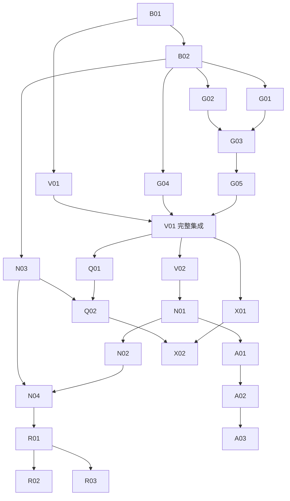

# Go 会计引擎与原生 macOS 开发计划

**执行顺序更新（2026-10-02）**：以[收敛交付计划](go-beancount-native-delivery-plan-2026-10-02.md)为准：先修复已知界面问题，冻结代码并完成当前账本/原生验收，打包、提交并交付可用首版，再继续附件及其余完整范围。下文旧“下一批”与旧基线保留为历史，不代表当前状态。

**当前实施基线（2026-10-01）**：Q02已实现有界查询执行、快照上下文、会话取消及真实C/Swift typed契约；完整工作台未完成。全量Go/七包race、51会计/147查询、原生三套/app及最新私人Swift/C通过（双方2833指令、零差异），见[本批证据](evidence/q02-bounded-execution-2026-10-01.md)。会计v3-core-3、默认legacy及查询contract保持；后台客户端与Store首批见[新增证据](evidence/q02-query-store-2026-10-01.md)；[QueryView/导航首批](evidence/q02-query-view-2026-10-01.md)已接入；错误位置与[保存query目录](evidence/q02-saved-query-catalogue-2026-10-01.md)已推进；下一步补preset、固定执行导出与完整验收。Q01剩余语义、X01/X02及GUI/安装/发行继续保留。

文档导航与当前差距见[开发入口](go-beancount-native-roadmap.md)；查询签名核对见[能力矩阵](query-capability-matrix.md)。当前剩余范围、估算口径及开工顺序在第15节。

前批Q01的91个strict场景见[历史Q01证据](evidence/q01-dynamic-null-query-2026-10-01.md)。cast及复合转换开工失败已修复，当前147场景通过；按本文第18节和实施手册第39节继续；不重做默认FROM、类型模型或已验stack。

执行时先读[当前进度](go-beancount-native-progress.md)。本文保留原始任务及设计步骤，标为“拟新增”的部分可能已有实现；以进度和当前代码判断剩余工作。现有严格门槛是 `make parity-full`，真实私有检查是 `make verify-private-ledger`；旧基线说明不作为当前通过规则。

初版：2026-09-30；更新：2026-10-01。本文定义完整任务与验收门槛，实际状态见当前进度。文档更新不构成实现或验收证据。

[文档交接复验](evidence/go-native-planning-baseline-2026-10-01.md)和[价格初版基线](evidence/go-native-documents-handoff-2026-10-01.md)保留历史 red。后续已完成 A02/A03 Store/UI 接入与自动化，价格请求校验和坐标序列化失败已修复；页面与客户端性能见[A03记录](evidence/a03-native-prices-2026-10-01.md)，最新全量、原生及私人检查见Q01证据。此前GUI尝试遇到系统捕获失败，当前文档整理未复测该工具，页面人工验收仍缺；不能宣称 M1–M3 完整验收完成。

依据：[设计文档](go-beancount-native-design-2026-09-30.md)。执行入口：[实施手册](go-beancount-native-implementation-2026-09-30.md)。旧原生计划中的已实现会话、Swift Store、分页、热重载和构建路径作为基线保留。

## 1. 开发原则与排序

先解决会改变库存、盈亏和有效性的核心缺陷，再交付可靠的多币种阅读，随后增加投资分析和查询。每个任务都要有独立验收信号，不能仅以“有页面”“构建通过”或“个人账本零错误”完成。

使用当前工作区作为起点，不能仅以 HEAD 重建项目。实施期间保留已有用户修改；不要把未提交的原生实现误删为历史实验。本计划不要求现在创建提交、PR、发布或改动个人账本。

新增会计行为先在显式 v3 配置交付。默认迁移是单独决策；它不阻止完成 fixture、配置入口、差分、核心修正和原生页面。

## 2. 里程碑与工作量

估算假设：一名熟悉项目的开发者连续投入，包含实现、必要测试和审阅；不包含等待证书、远端 runner 或旧系统机器的时间。这些是初版全范围估算，不是当前剩余工期。核心已有实现后，按进度与新增验证复杂度重新评估剩余批次。阶段中的任务不是简单相加；可复用投影和证据。

| 里程碑 | 内容 | 估算工程日 | 退出条件 |
| --- | --- | --- | --- |
| M0 | 记录可复现基线，固定显式配置与迁移契约 | 1–2 | B01 完成，B02 的契约部分确定；配置代码与比较界面纳入 M1 |
| M1 | 显式配置落地，批次/booking/容差/AVERAGE 修正，差分可信化 | 8–12 | B02、G01–G05 核心及 V01/V02 当前范围通过；已知核心 P0 在 v3 配置无剩余失败 |
| M2 | 多币种报表与趋势，原生验收与开发包 | 5–9 | N01–N04、R01；已声明环境完成阅读循环 |
| M3 | 账户、持仓、价格原生分析 | 9–14 | A01–A03 及 G05 均价联动；金额、日期、批次与收益可追溯 |
| M4 | 声明范围 BQL、原生查询、全指令、附件与导出 | 8–13 | Q01/Q02、X01/X02；能力矩阵及端到端验收一致 |
| 发布扩展 | 远端 CI、目标系统与公开分发 | 工程工作约 2–4；外部等待另计 | R02/R03 有真实证据，或明确限定为开发包 |

M0–M2 合计约 14–23 个工程日；M3–M4 另约 17–27 个工程日。完成上述分析版约 6–10 个工作周；不包含完整 BeanQuery、原生 authoring 或导入生态。旧计划的 12–18 日是旧范围的估算，不能与本计划再全部叠加。

允许 M2 的 GUI/系统验证在 M3 的独立投影开发期间继续，但不得把未完成的 M2 验收写成已通过。R03 外部条件缺失时照常完成其他任务。

阶段入口按已依赖的行为判断，不按整个跨阶段任务的总状态判断。M1 核心门槛包括 G05 的 booking、精确数学、守恒及已有 CLI/C/Swift 归约输出；G05 的持仓均价末点和原生均价图联动在 M3 与 A02 一起验收，仍属于必须完成的范围。否则 A02 依赖 A01/M1、M1 又等待 A02，会形成循环。N03、N04、V02 和 D01 同样随新增页面逐阶段扩展：M2 先验当前四页，M3/M4 再验新增页；早期页面通过不代表整个任务永久完成。

## 3. 任务清单

下表保留完整任务定义与依赖，不是当前状态表；“已有”列是初版时可复用的基础，更新后的实现及剩余门槛见进度。

| ID | 任务与产物 | 前置 | 已有基础与主要落点 | 验收摘要 |
| --- | --- | --- | --- | --- |
| B01 | 记录当前源码/工具链/输入基线，固化失败样例 | 无 | status、现有测试、reference、native tests | 可复现 4 类缺陷；原有通过项和未验项分开 |
| B02 | 显式 semantics、迁移比较和身份契约 | B01 | EvalOptions、BuildOptions、CLI、desktop、bridge、Swift | 同源不同配置不同快照；切换无串账；ADR 状态准确 |
| G01 | 补入 acquisition 隐含成本日期并统一批次键 | B02 | evaluator、成本/库存 tests | 省略日期 LIFO 正确；日期/label 通配与身份完整 |
| G02 | 全局/账户 booking 优先级与校验 | B02 | options、open、parser | 全局 LIFO/AVERAGE 生效，账户覆盖，未知方法失败 |
| G03 | STRICT/SIZE 与失败归约处理 | G01/G02 | bookPosting、allocate、interpolation | 歧义不能有效发布；SIZE 与上游一致；失败不变库存 |
| G04 | 交易与断言容差选项 | B02 | options、infer tolerance、balance | multiplier/default/显式容差与固定 oracle 一致 |
| G05 | AVERAGE 完整启用与守恒验证 | G01/G02/G03 | ADR-0042、现有 average tests/charts | 数学守恒、连续买卖、日期、全局/账户均通过 |
| V01 | 差分模型、公开语料、严格退出码与 CI 入口 | B01；最终集成依赖 G01–G05 | compat、reference、parity、golden | 完整批次和分录重数；扩展与普通兼容分开；未知边界失败 |
| V02 | 私有账本临时对照与真实原生读取 | V01/B02/G01–G05 | 外部账本、私有脚本、Swift contract | 汇总摘要可重复；无私人内容入库；无泛化等价措辞 |
| N01 | 原币优先与部分折算报表 | M1 | native_statement、desktop DTO、ReadingControls | 缺汇率仍有完整原币；部分值不能冒充总计 |
| N02 | 原币趋势与每时点估值 | N01 | charts、native statement、Dashboard | 多币种分开；无未来报价；缺点不置零/连线 |
| N03 | 新协议与扩展页面的状态/生命周期 | B02；每个新增 DTO 同步进行 | 现有 Store、BridgeClient、Swift tests | 代次/请求/快照一致；错误与旧快照分开；关闭释放 |
| N04 | GUI、键盘、辅助功能与性能验收 | N01/N02/N03 | 旧验收清单、QA、benchmark | 阅读循环、拖入、最小窗口、大字体、交互记录 |
| R01 | 开发包构建、许可、元数据与本机安装循环 | N04 | mac-check/package/check-bundle | 独立解压启动、修改、错误、恢复、退出通过 |
| R02 | 远端 CI 实际执行和差分门槛 | V01/R01 | 现有 macos.yml、CLI release | 真实 run 记录；新增门槛会失败；不只检查 YAML |
| R03 | 目标机器/旧系统与公开签名分发 | R01；公开分发还需 R02 | 支持矩阵、package | 实机范围明确；Developer ID/公证/安装实证 |
| A01 | 账户详情与页面返回状态 | M1/N01/N03 | account intervals、journal、树选中 | 直接/子树、日期、booking、来源一致 |
| A02 | 截至日持仓、完整批次和收益事件 | A01/G05 | holdings、inventory、charts | 历史不是过滤现仓；毛/净收益边界明确；M 腿不重复计入 |
| A03 | 价格历史与报价可用性 | A02 | prices/commodities、price map | base/quote、as-of、缺价/陈旧、无网络抓取 |
| Q01 | BQL 语法与类型能力清单 | M1/V01 | query parser/eval、query parity | 默认 FROM、分批函数、类型/NULL/错误通过 oracle |
| Q02 | 原生查询工作台与结果导出 | Q01/N03 | desktop Read、BridgeClient、Store | 快照绑定、过期结果丢弃、行/字节预算、CSV 精确 |
| X01 | 全指令 Journal 与配置来源列表 | M1/N03 | Entries、journal index、DTO | 模式/计数/元数据/来源清楚，分页不跨快照 |
| X02 | 文档关联、外部打开与分析导出 | X01/Q02 | document/source actions、query CSV | 路径范围、失效附件、原子导出、口径完整 |
| D01 | 能力/证据/支持矩阵与文档收尾 | 每个里程碑分别执行 | README、development、progress、验收记录 | 实现/检查/GUI/系统验收分开；未验证项保留 |

R03 完成条件取决于最终发行目标：只交付开发包时记录未完成的公开分发项，不能将整个任务标为公开发布完成。

## 4. 依赖与可并行工作



这张图表达任务依赖，不要求使用多个 agent。若以后明确采用并行开发，先划分文件责任：ledger/options 与 compat/reference 可在稳定结构上协作；原生 DTO/协议应有单一负责人；两个任务同时修改 `Models.swift`/`session.go` 时先收敛共同契约。

G04 与 booking 修正可独立推进。V01 的生成器/差分结构先完成，等 G01–G05 修正后集成。原生页面不依赖远端签名完成，但必须使用 M1 已验证的会计配置。

## 5. 交付批次

当用户授权实现及提交时，按下列行为范围拆分提交；本次文档任务不创建提交。

| 批次 | 内容 | 必须保持的状态 |
| --- | --- | --- |
| C01 | 基线和 oracle/差分工具修正 | 当前默认行为不变，生成器可重复 |
| C02 | 显式配置、快照身份、CLI/会话/Swift 贯通 | 能构建，旧默认仍可使用，配置可见 |
| C03 | 日期、booking 优先级与 STRICT/SIZE | 每个缺陷有先失败的回归，再修正；不能只提交黄金更新 |
| C04 | 容差与 AVERAGE 完整验证 | v3 兼容例子与 extension 例子分开通过 |
| C05 | 严格公开/私有检查与 M1 证据 | 净差分为零或精确登记；不提交私人结果 |
| C06 | 多币种报表与新 DTO | Go/C/Swift 同批更新，金额与状态正确 |
| C07 | 趋势、GUI、打包与 M2 证据 | 原币与折算均有真实操作记录 |
| C08 | 账户详情、持仓、价格，逐页交付 | 每页可独立核算和回归，沿用统一会话 |
| C09 | 分批 BQL、原生查询 | 声明范围准确，类型结果不被显示字符串替代 |
| C10 | 全指令、附件、分析导出与 M4 收尾 | 只读源文件，导出明确目标，支持声明真实 |

不以“测试代码 / 产品代码”机械拆分长期红灯提交。开发中先 red 后 green；进入默认分支的批次应可构建、检查通过，不带永久 skip。

## 6. 验收门槛

### M1

- G01–G05 的公开合成样例全部有固定结果，v3 的合法性/booking 与 pinned oracle 一致；AVERAGE 按独立数学与守恒通过。
- 同源不同 profile 快照不能共享身份、缓存或会话；旧结果迁移有显式入口和差异展示。
- V01 的新格式不再忽略成本日期/label/分录重数；差分命令发现未登记差异返回非零。
- V02 对个人账本仅保留聚合报告；余额一致之外检查完整批次、关键期间和真实原生载荷。
- `make fmt vet test race license build mac-check` 通过；共享核心影响方言/导出/Web 时完成相应 targeted 检查。

### M2

- 缺汇率的原币报表可读；所选目标币种不可完整折算时保留原币信息，完整总计不可用，已折算部分明确标识。
- 趋势按币种/时间点计算；历史缺价不置零，资产/负债和收支口径一致。
- 当前 fixture 的查看、连续错误、修复、include 变化、双窗口、关闭轮询与过期响应均验证。
- GUI 清单包含精确窗口、大字体、拖入、来源打开、键盘/AX；性能按独立样本记录，不引用桥接耗时代替 GUI。
- R01 本机独立开发包阅读循环完成；目标机器/公开分发的未验证项不能被折算为“通过”。

### M3

- 手算/公开 oracle 对照截至日库存、均价、成本、市值、可确定的收益。
- 全清、重新买入、不同成本币种、无售价归约和费用不明均有明确状态。
- 账户选择、返回栈、快速切换与热重载保持同一请求/快照；价格不使用未来数据。

### M4

- Q01 能力矩阵逐格有测试或明确拒绝，查询 preset 全部可运行。
- 查询及全指令模式真实 Swift 解码、分页/取消/乱序和 GUI 关键操作通过。
- 文档路径范围、失效附件和导出失败安全得到验证；CSV 金额与当前投影完全一致。
- D01 更新产品能力与限制；不使用“完整 Fava / Beancount 等价”概括未测范围。

## 7. 风险与处理

| 风险 | 触发信号 | 处理 |
| --- | --- | --- |
| 修复改变旧账本结果 | v3 与 legacy 的有效性/库存/收益不同 | 保留同输入比较，显式切换，不覆写源文件 |
| golden 掩盖缺陷 | 为了通过去掉字段、取 abs、四舍五入或扩大 boundary | 停止更新期望，核对 oracle 与数学依据，修差分模型 |
| v3 语义长尾扩大 | 新 fixture 暴露 self-reduction/多币种推断等 | 修影响本轮正确性的项；其他明确诊断/范围记录，不静默猜测 |
| 多币种部分值误导 | 一些报价缺失却仍显示完整净资产 | 独立 completeness 与 total，GUI 验证标签及导出 |
| 投资收益归因错误 | 有费用、转账、无价格或多商品交易 | 只展示可证明的毛收益，费用/净收益未知不猜测 |
| 查询类型扩展变大 | 为了一个函数引入全 SQL 或所有 inventory 语法 | 用能力矩阵分批，固定 Q01 最小交付，不扩大 M4 承诺 |
| GUI/签名环境不可用 | 捕获、旧机器、证书或 runner 缺失 | 完成独立任务并记录具体缺口；不反复重试代替证据 |
| 旧修改被覆盖 | 用 git reset/clean/recheckout 回到 HEAD | 先 B01 保存基线，修改局部文件，不回滚他人修改 |

## 8. 进度记录规则

持续更新已有 `docs/go-beancount-native-progress.md`。每个任务记录：状态、适用源码版本、输入/oracle、执行命令、实际结果、未覆盖项和下一步。任务状态建议为待实施、进行中、实现完成、检查通过、人工验收通过、外部条件未满足。

实现完成、检查通过和 GUI/目标机器验收不是同一状态。不能因为剩余任务都依赖外部条件，就将整个分析版或公开发行标成完成。

后续开发指令可直接指定“执行 B01–M1”“继续 N01–R01”或某个任务编号。执行者须先阅读相关设计节与实施手册，沿用最近的实际进度，而不是从第一行重新开发。

## 9. 按当前基线继续开发

以下是 2026-10-01 的执行建议；实际开工仍先核对进度及相关代码。不得把全范围估算当成重新实现已经完成的核心所需时间。

| 顺序 | 开工事项 | 具体交付 | 可转入下一项的条件 |
| --- | --- | --- | --- |
| 1 | 收敛 M1 剩余验收和 N03 契约 | 核对 46 个 full oracle、两项 AVERAGE 扩展、迁移详情；保留已通过回归，补当前确有缺口的链路 | 无已知会改变有效性/库存的未解释失败；仍需 A02 的均价末点明确保留 |
| 2 | N04 / R01 | 公开账本 GUI、实际窗口尺寸、大字号、中英文/外观、键盘/AX、GUI 计时；独立解压开发包阅读循环 | 验收表有输入、实际环境、动作与结果，未验项不写通过 |
| 3 | A01 剩余验收 | 复用已有账户详情实现与自动化检查，补 GUI 进入/返回/重载及新私有投影检查 | direct/subtree、生命周期、返回状态、来源及快速切换一致 |
| 4 | A02 | 截至日 lot 重放→持仓/均价→可确定归约事件→原生展示 | 清仓重买、M 排除、费用未知、价格不足和精确数学检查完成 |
| 5 | A03 | 本地价格列表/时间序列与共享 PriceAt 使用说明 | 所有商品可见，无报价/陈旧状态与截至日选择正确 |
| 6 | Q01 / Q02 | 按能力矩阵分批补 BQL；每批贯通 CLI/桥接/原生 typed 结果 | 当前声明范围各格有检查；预算、迟到结果和 CSV 不丢类型 |
| 7 | X01 / X02 | 全指令及配置浏览→附件→固定投影分析导出→AVERAGE 源导出边界 | 分页/路径/原子保存与 round-trip 边界验收完成 |
| 8 | D01、R02 / R03 | 整体 gate、支持/能力矩阵；具备条件再做真实 CI 与目标系统/公开分发 | 报告与产物一致；外部缺口逐项记录 |

N04 的 GUI 工作与 A02 等独立投影可在依赖满足后交错进行。每个页面完成再接下一页，避免一次扩展全部 DTO 后才发现协议/导航错误。远端 CI 与目标系统不阻止完成本机功能，但没有证据时限制发行声明。

当前 A01/A02/A03 已有投影、typed模型、Store/UI与自动化，Q01已有标量类型基础；第9节顺序表是原任务依赖，已实现内容只保留回归，具体剩余顺序按第15节。当前私有只读对照为2,831条指令、支出73行/收入22行一致，真实 Swift/C 根汇总及三个截至日持仓通过；自动化不替代 GUI。

## 10. 单任务交接格式与范围调整

每个任务用一个简短记录落实以下信息，可写入现有进度而不创建新的状态体系：

```text
任务：A02
起点：当前工作区及 A01 接口；profile=v3；依赖已检查/缺口
目标行为：截至日持仓重放，M 不计作出售
负责文件：report/desktop/bridge/Swift 具体文件
检查接口：snapshot/report/desktop、真实 C/Swift、Store generation
公开输入与独立预期：fixture、精确数量/成本/收益
实施：本轮实际变更
验证：命令、结果、GUI 动作、适用环境
剩余：明确未验证项及下一任务
```

新增会改变数据含义的能力先修订设计契约和验收场景，再实现。单纯函数/文件命名无需重新审批。超出本计划的 authoring、全 SQL、联网抓价或跨平台发行需独立任务；不得通过宽泛 boundary、删除场景或变更 expected 静默缩小验收范围。

一项任务只有实现和自动化证据时标为“检查通过”；涉及 UI 的人工操作完成后才标“人工验收通过”。旧系统和公开签名属于独立环境证据，开发包可交付不意味着它们完成。源码若又发生相关变化，注明哪些证据失效，仅重做受影响检查。

## 11. A02 的可执行开发批次

本表细分 A02，不增加顶层任务数量。沿用[设计第 20 节](go-beancount-native-design-2026-09-30.md#20-投资投影的计算及归因契约)和[实施第 26 节](go-beancount-native-implementation-2026-09-30.md#26-a02-从当前代码继续的实施清单)。默认验收 profile 为 v3；legacy 既有读取不得被连带破坏。

| 批次 | 负责位置 | 实际动作 | 通过信号 |
| --- | --- | --- | --- |
| A02.1 重放及身份 | ledger 重放、report holdings/history、公开 fixture | 复用连续 AVERAGE；补 FIFO/LIFO、完整日期/label、无成本/零成本、NONE、同日清仓重买及最终 oracle 对照 | 每个 cutoff 的独立库存/成本；无输入变更；完整身份与同日顺序正确 |
| A02.2 归约及费用 | report reductions、desktop tests | 补 @/@@ 拆分、转移、短仓、缺价格/事件日汇率、显式费用及结算不符；来源分组不吞重复交易 | 原始售价一次计入；可确定收益精确，未知 reason 可解释；M 不重复 |
| A02.3 分组及估值 | report、desktop request/DTO | 固定 group_by、quote/completeness、目标成本和未实现差额；落实分页、选择器和字节预算 | 不跨数学域；不使用未来价；缺成本/价格可区分；参数不被忽略 |
| A02.4 真实跨语言 | bridge、Swift Models/ContractTests | 对真实 Go 载荷解码；required/null/empty/未知枚举负向检查；内存释放 | 精确有理数字符串与币种保留；错误字段不能变合法零 |
| A02.5 原生操作 | LedgerStore、HoldingsView、读取控件 | 持仓入口、分组/批次、均价段、收益列表/原因、来源与账户导航；受控 cutoff/页面/账本乱序 | 最新请求发布；重载不拼旧分页；关闭无新调用；原偏好保留 |
| A02.6 集成验收 | fixtures、benchmark、私有脱敏检查、文档 | 当前全量 gate、GUI 和持仓页性能；针对实际新增投影扩展 V02 | 自动化/GUI/性能各有独立记录；只读私人输入；能力声明一致 |

每批先固定能失败的行为例子，再实现和收尾；不要先开发完整 UI 再发现库存口径错误。A02.3 之前的第一批响应不是正式完成的数据契约。跨语言批次完成后再暴露产品入口，避免将未实现的市值/筛选控件呈现为可用。

N04/R01 的 UI 工具缺口不会阻止 A02.1–A02.5 的代码和自动化工作；实际 GUI 尚不可验证时保留验收项，再推进 A03/Q01 等独立工作。不能通过减少验收项目来完成里程碑。

## 12. 交付记录与后续开发使用方式

每个任务的开发输入是设计契约、计划依赖、实施预期及当前进度四者，不能仅依据一张旧状态表。以下模板可直接附加到现有 progress：

```text
ID / 批次：
输入与实现版本：HEAD + 相关 dirty 文件身份，profile/revision，公开 fixture 哈希
前置与目标：哪些前置已检查；本批要改变的具体行为
变更位置与契约：Go、C、Swift、UI、文档
独立预期：手算或 pinned oracle；合法/非法与精确值
当前验证：targeted / 全量 / 真实 C+Swift / GUI / 性能，逐项列结果
继承证据：来源及仍适用的输入、源码、环境
未完成：已知失败、尚未实现、尚未验证、外部条件分别记录
下一步：一个具体批次及其通过信号
```

若用户指令为“按文档开始开发”，从实际第一个未完成批次进入；若为“修订计划”，只修改文档和必要只读证据。实现授权不自动包含提交、远端 CI 触发、修改私人账本或公开发布。文档修订也不自动撤销既有实现要求；持续任务中按最新明确范围安排当前批次。

设计行为改变时先同步相应验收场景和任务退出条件；代码完成后更新 progress，不反向删除旧失败预期。最终交接给出三个主文件、当前完成范围和剩余入口，不用总代码量或测试通过率估算产品完成百分比。

## 13. 当前剩余工作与实际开工顺序

此表按本次代码检查更新；原 Store red 已修复，不重新列为开工项。24个顶层任务及完整里程碑范围不变，已有代码不等于退出条件满足。本次只修订文档和只读复验，不继续修改产品代码。

| 顺序 | 当前差距 | 开工切片与产物 | 结束时必须证明 |
| --- | --- | --- | --- |
| 1 | A03.1：后端与当前回归已通过 | 保留合法参数、源重数/日期/倒数/零/缺价/预算/极大精确值回归 | 后续价格改动继续运行既有8个价格及1个共用图表检查，不重做旧red |
| 2 | A03.2 / N03：原生链路及性能已有，GUI缺 | 保留typed Models/Store/PricesView、真实C/Swift、公开69价格和私人目录/48可用性检查 | 参数/偏好/时序green持续有效；12–24ms客户端证据不代替GUI |
| 3 | A01/A02/G05 与 A03：新页 GUI 仍缺 | 保留已有 HoldingsView 与性能证据；补账户/持仓/价格的阅读、来源、图表、返回和热重载 | 各页真实交互记录；精确值与曲线分段符合公开输入，不能用构建/解码替代 |
| 4 | Q01 / Q02：BQL 长尾与原生查询 | 补剩余类型/函数oracle；复用已实现typed执行与预算，接后台客户端、Store、工作台与导出入口 | 类型/NULL/错误/重数可核对；旧 CLI/Web 适配路径仍可用 |
| 5 | X01 / X02：完整记录及附件/导出 | 已求值与源配置浏览、附件解析、固定投影保存、源导出扩展拒绝 | 重复记录不吞掉，路径检查与失败保存安全，导出内容与捕获范围一致 |
| 持续 | B02 / A01 / N04 / R01 / D01：已有页面仍有验收缺口 | 迁移详情复看、账户页 GUI、窗口/字体/键盘/AX、独立安装循环、支持矩阵 | 每项均有当前适用输入和环境；客户端计时不代替 GUI |
| 条件具备后 | R02 / R03：外部执行与发布环境 | 授权后真实远端 run；目标机器、证书、公证及安装证据 | 不通过改状态或检查脚本代替实际执行 |

第1→2项已有当前实现与自动化，保留回归；第3项 GUI 条件不足时准确留项，继续第4→5项独立开发。持续项在相关页面变更后补齐。GUI 工具或旧系统缺失只阻止相应验收；不能阻止完成查询等独立代码，也不能因此将里程碑标为完成。

初版 6–10 周是全范围工程估算；本次不根据代码行数或 46/46 样例推算“剩余百分比”。开始实施后以一个已完成纵向切片的实际耗时重新估算 A02–X02，单列 GUI/远端/签名等待，不将当前已完成核心再算一遍。

后续开发可直接使用：

```text
按三份 Go/native 主文档继续开发。
先读当前 progress，planning-baseline 作为历史证据，保留现有 working tree。
实施第28节的 Store/UI 已实现；保留回归、A02客户端性能与私人持仓证据，补 GUI。
第30节 A03 与第33节 Q01基础已有实现及检查；保留GUI缺口，从第37节剩余查询语义 → 第31.2节 Q02 → 第32节 X01/X02继续。
按设计第24–26节固定契约，并完成相关 N03/N04/V02/D01。
每个切片记录当前验证及继承证据；不改私人账本，不自行提交、触发远端或发布。
```

## 14. 后续开发批次的交付与停止条件

本节将剩余任务拆为可审阅的纵向交付，细节见实施手册第30–32节；不增加第25个顶层任务。每次进入下一批前都保留前批回归和未完成 GUI，不用“代码完成”关闭人工验收。

| 批次 | 必须提交到工作区的产物 | 退出条件 | 尚需的外部条件 |
| --- | --- | --- | --- |
| A03 后端 | 完整请求校验、价格目录/历史/选价回归、bridge 错误（已有当前实现） | 已有green；后续保留真实历史重数/来源和snapshot分页回归 | 无 |
| A03 原生 | DTO、Store、价格页、持仓跳转、基准及契约检查 | Models/State/NativeClient 三套实际执行；新页客户端延迟有独立样本 | GUI 实际操作仍单独验 |
| Q01 基础与类型 | 能力矩阵、pinned query golden、typed Go 结果和旧输出 Adapter | 每个声明签名有正反例；重复标题、多币种、NULL 不丢值；CLI/Web gate | oracle 环境已由 lock 固定 |
| Q02 工作台 | 执行记录、后台队列、typed 表、预算、错误与导出捕获 | 草稿/执行结果身份分开；迟到/失败不冒充当前成功；预算边界有效 | GUI 执行/取消/保存验收 |
| X01 全记录 | 有效指令与词法配置索引、typed 详情、原生模式切换 | 指令逐类覆盖；重复/生成记录身份正确；交易总数不变 | GUI 浏览/分页/重载验收 |
| X02 文件 | 附件解析、打开前校验、版本1分析容器与CSV、源导出边界 | typed 往返、固定快照、取消/失败不毁旧文件；无损边界明确 | 系统打开与保存面板验收 |
| N04/R01 收尾 | 完整验收记录、隔离独立包、支持矩阵 | 阅读/错误/恢复/退出循环；字体/窗口/键盘/AX及GUI性能均有实测 | GUI 控制/捕获恢复 |
| R02/R03 | 真实远端 run、目标机器、签名/公证/安装证据 | 实际声明发行范围对应证据；没有时保持开发包声明 | 远端授权、机器、证书 |

采用一批一个明确责任范围：价格集中 report/desktop/bridge 与价格 Swift 文件；查询先 query 值模型及 Adapter，再扩展 desktop/Swift；附件文件处理独立于 ledger 求值。任何跨公共 Models/Store 的改动在同一批完成契约与时序验证，不让下一批继承已知编译失败。

估算以第2节原始全范围工程日为上限背景，不据当前文件数计算完成率。完成 A03 后记录实际实现/检查/GUI耗时，再分别重估查询类型、原生工作台、全记录和文件功能；外部等待单列。若新 oracle 暴露影响正确性的缺陷，写清失败输入及所属任务后修复，不能扩大豁免或默默降低验收门槛。

文档交付完成条件：三份主文档的范围、字段、任务号和检查命令一致，实际 red/green 与继承证据分开，后续第一步可以直接执行。产品完成条件仍为各里程碑退出门槛，二者分别报告。

## 15. 当前剩余范围、估算与开发顺序

前轮整理文档没有修改产品源码；随后复合批次继续实施，元数据阶段见[历史证据](evidence/q01-metadata-query-2026-10-01.md)，当时共63场景通过。动态/NULL批次91场景见第17节及[历史证据](evidence/q01-dynamic-null-query-2026-10-01.md)；当前147场景及后续入口见第18节。完整Q01尚未完成；原生查询执行协议已实现，工作台尚未接入。16个早期探针与22个基础golden保留历史身份，不作为当前缺少typed或compound入口的依据。

下表保留此前文档规划时的工程日区间，单人熟悉项目、连续投入、含必要验证。Q01基础推进后尚未重新测量工时，因此区间只能作预算参考，不能称为当前精确剩余工期。完成下一显式转换/精度切片后按实际耗时重估Q01；其余任务按各自验收结果滚动更新，不与第2节全范围估算相加。共享Models/Store/协议由一个批次统筹修改。

| 剩余批次 | 估算工程日 | 主要不确定性/退出信号 |
| --- | --- | --- |
| Q01转换修复、剩余签名、精度及预设 | 原预算3–5，待重估 | 已有标量/默认来源不重做；金额/持仓/库存和已验词法stack保留；剩余NULL、动态类型、签名、预设逐项strict golden通过 |
| Q02原生工作台、状态及预算 | 2–4 | 同步C取消范围、编译/分组/排序成本；真实跨语言/时序和GUI通过 |
| X01完整指令与配置来源 | 2–3 | 重复/生成关系、include词法索引；逐类payload、计数及重载验证 |
| X02附件与固定分析导出 | 3–5 | symlink、精确compound序列化与写失败；往返、保存取消/失败和系统操作 |
| N04/R01/D01集成与独立开发包验收 | 2–4 | 各页GUI、AX、字体与窗口、安装/错误/恢复循环；实际验收证据 |
| 历史规划合计 | 12–21 | 非当前实测剩余工期；oracle新缺陷曾预留1–3日，远端/机器/证书等待另计 |

R02/R03工程工作沿用第2节单列约2–4日，实际等待不计入上述合计；没有远端运行/目标机器/证书时只声明本机开发包。若查询元数据要求新的核心行为，先根据最小失败输入调整对应G/V/Q任务的剩余估算，不新增无限兼容承诺。

从当前实现按以下顺序执行，保持24个顶层任务编号。具体修改位置、独立预期与升级检查见实施手册第36节：

1. **Q01.2持仓值（已有检查）**：Position完整成本/date/label、无成本/零成本及公开序列化/gate已通过；保留回归，不重做。
2. **Q01.2重载与库存（已有检查）**：units/cost(position)、weight列、number/currency(amount)、sum(position/amount)、units/cost(inventory)、排序和空库存已通过；高精度一般算术仍单列。
3. **Q01.1有效元数据（本轮已验范围）**：来源键、显式NULL/空/false优先级、文件内词法stack及include独立作用域、pad元数据已验；重复include/metadata、保留键覆盖等另列待验，不冒充完整loader兼容。
4. **Q01.3剩余签名与预设**：动态比较、完整NULL逻辑、unary/日期/聚合、精度边界及可执行收支/余额/来源预设；逐格更新矩阵、CLI帮助与旧调用方回归。
5. **Q02**：desktop/bridge → Swift Models → Store → QueryView →预算/GUI；随后X01全指令/配置与X02附件/固定分析文件。N03/N04/V02/D01随每页扩展。

实际已有命令为`make query-parity query-oracle-check`；normal gate只读，`make query-golden-regen`仅用于审阅后的显式更新。矩阵内明确拒绝项不能变成普通通过豁免。GUI/安装工作可与上述独立代码交错推进；历史捕获失败需按当前环境复核，不能预先断言工具仍不可用。远端CI、旧系统及签名单列R02/R03，不作为独立功能开发的等待条件。

## 16. metadata阶段交接与后续工作包

metadata批次推进了Q01/V01，并改变v3 revision；实际状态见[当前证据](evidence/q01-metadata-query-2026-10-01.md)。不新增顶层任务，不按测试数量计算完成百分比。第15节工程日是旧预算参考；本轮没有工时采样，不能据63场景推导精确剩余天数。

| 顺序 / 任务 | 输入与修改责任 | 可审阅产物 | 退出门槛 |
| --- | --- | --- | --- |
| 1 / Q01.3 | NULL/动态类型fixture、typed编译/比较/共享求值 | 实际类型驱动的比较及NULL传播，收敛旧coercion路径 | pinned正负例；零行仍校验；旧CLI/Web回归 |
| 2 / Q01.3、G/V长尾 | 重复include/metadata、保留键、同日跨文件顺序 | 明确兼容或明确拒绝；必要时更新v3 revision | 完整分录/错误类/source/legacy隔离；不吞错或重复计数 |
| 3 / Q01.2/3 | 日期/聚合、balance时序、sum(inventory)、Decimal精度 | 逐签名矩阵、可运行收支/余额/来源预设 | 每签名独立oracle与负例；扩展单列；预设实际运行 |
| 4 / Q02、N03 | desktop/bridge、Swift Models/Client/Store、QueryView | 同快照原生查询、typed表格、定位错误、CSV | 跨语言；乱序/重载/关闭；预算/取消及GUI |
| 5 / X01、N03 | 源配置索引、全指令DTO、Journal模式 | transaction/all/config浏览及明确计数 | 每种指令、生成关系、metadata/source；分页同快照；原生/GUI |
| 6 / X02 | 附件路径状态、Go固定内容、Swift保存/打开 | 附件与version1分析文件、独立CSV | 路径/symlink、原子写、NULL/compound往返、失败/取消 |
| 7 / N04、R01、D01 | 全页操作、QA、独立开发包 | 窗口/字体/键盘/AX、错误恢复与安装循环、支持声明 | 当前包实际证据；客户端延迟不替代GUI |
| 8 / R02、R03 | 远端CI、目标机器及发行凭据 | 真实run、实机和签名公证记录 | 外部条件满足后执行；准确限制分发范围 |

每包按一个纵向行为推进：独立期望和真实red → 最小实现 → targeted green → 适用全量门槛。现有63个query/50个会计案例持续保留。新错误同步双语diagnostic、修复指引及触发fixture，不能只满足会计gate。

Q02可先做协议和受控Store，但帮助/preset只列Q01矩阵已经验过的能力。N04可穿插验收已有页面；最终核对新增路由影响的导航、窗口状态与错误恢复。完整目标仍按第6节及固定24任务验收。该表1的已验动态/NULL子集在后续批次落地；最新具体入口为手册第37节。

## 17. 历史动态/NULL批次的执行顺序

第16节工作包1的已验object转换、NULL、unary/短路和动态WHERE已落地，当前91场景见[证据](evidence/q01-dynamic-null-query-2026-10-01.md)。隐式转换不等于显式转换函数已交付；第16节包2–8及包3的剩余签名/库存/精度/预设仍保留。下一步按手册37.1选一个显式转换重载建立oracle/red，再顺序完成Q01声明范围；Q02的协议可在稳定typed形状上推进，GUI/取消/预算仍必须独立验收。旧工程日区间不因28新增场景自动重算，完整24任务目标不缩小。

## 18. 本次交接后的执行批次与交付物

本表接管第17节的开工排序；24个顶层任务及退出门槛不变。当前源码已完成已验标量/复合转换、Decimal成本/库存上下文及表示，当前147场景通过；包1补分组/库存与数值/复制长尾，随后继续包2–8，不能从旧函数全部缺失或旧失败重新开工。估算仍采用第15节历史预算，尚无可靠实测支持新的剩余天数或完成百分比。

| 顺序 | 对应任务 / 责任范围 | 本批可审阅产物 | 退出门槛及后继 |
| --- | --- | --- | --- |
| 1 | Q01 / typed、coercion、casts、compound、公开语料 | 报价表示、日期提取与聚合端点已验；补分组、balance/库存、预设及数值/复制长尾 | 当前147场景保留；新增逐重载场景通过；财务身份稳定 |
| 2 | Q01、V01 / 查询编译与运行值 | 固定日期/聚合重载清单、group/alias规则、balance时序与sum(inventory) | 每项正反例和空输入签名；动态/完整批次不丢；未支持项准确拒绝 |
| 3 | Q01、G/V / 数值与loader长尾 | 查询Decimal上下文、高精度算术/聚合案例；重复include/metadata等明确行为；可执行预设 | 精确会计不被舍入改变；oracle/扩展分别通过；预设经CLI运行 |
| 4 | Q02、N03 / desktop→bridge→Swift | 快照绑定执行、错误位置、typed表格、预算/真实取消、结果CSV | 真实C/Swift、Store乱序/关闭/重载、资源边界及GUI操作 |
| 5 | X01、N03 / 索引与Journal | transaction/all/config模式；每类指令payload、生成关系、保存query浏览 | 全类型公开输入；计数/来源/分页同快照；原生及GUI |
| 6 | X02 / 文件路径与分析投影 | 附件状态/系统打开、固定分析容器和CSV、同快照导出 | symlink/失效/越界、往返、取消/写失败；系统面板真实验证 |
| 7 | N04、R01、D01 / 全页和包 | 键盘/AX/窗口/字体记录；独立解压包阅读、错误、恢复、退出循环 | 当前包实际验收；产品能力/支持矩阵与证据一致 |
| 8 | R02、R03 / 远端与发行 | 实际CI run、目标系统/机器记录、签名公证及安装证据 | 对应发行声明的真实证据；等待外部条件时继续独立任务 |

每批记录输入、工作区身份、独立期望、实际检查与未验范围。修改query值模型后先验证query/compat/CLI，受共享执行链影响时升级全量Go/race与会计门槛；涉及原生协议时Go和Swift同批交付。新诊断同步双语指导及触发fixture。不得把文档规划、已写测试、通过自动化、GUI验收或公开发行互相替代。

**下一次开发首个交付**：按实施39节补分组/aggregate位置/alias/ordinal、balance/sum(inventory)时序与预设；日期和聚合端点的已验重载保留回归。Q02协议可按31.2节在稳定typed schema上推进，资源预算与实际取消不由现有LIMIT代替。当前147查询/51会计、v3-core-3及完整当前检查见[本批证据](evidence/q01-date-aggregate-price-2026-10-01.md)。历史开工red与旧身份保留，不减少24任务目标。
