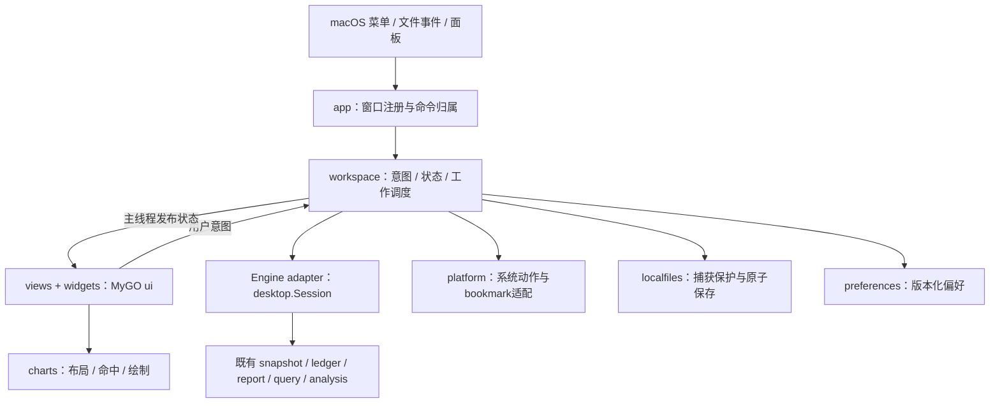
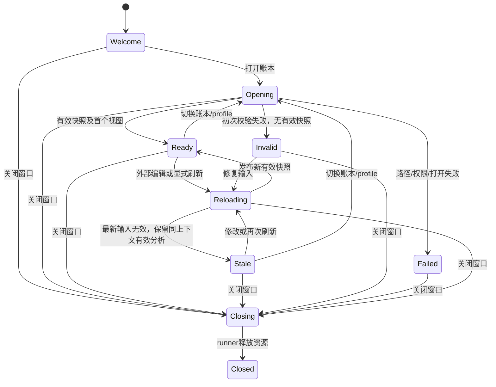

# OrangeCount MyGO Go ui 桌面客户端详细设计

日期：2026-10-07。状态：技术路线已由用户确定，实施进行中；本文是持续更新的设计基线，不代表任务或产品验收完成。实施顺序见[计划](mygo-native-desktop-plan-2026-10-07.md)，任务状态的唯一入口见[任务台账](mygo-native-desktop-tasks-2026-10-07.md)。架构决策见[ADR-0051](adr/0051-use-mygo-native-go-ui-for-the-desktop-client.md)。

## 1. 目标、范围与证据

目标是用 MyGO `ui` 交付可以替代现有 SwiftUI macOS 阅读版的 Go 桌面客户端。全部业务窗口使用 `WindowOptions.Content: ui.View(...)`；展示代码直接消费 Go 的类型化结果。会计引擎、账本格式、默认语义配置及原有 Web/CLI 行为保持既有契约。

首个完整版本覆盖现有 macOS 账本加载、报表/趋势、账户/流水、全指令/配置、持仓/价格、诊断、查询/预设、分析文件读取与报表/查询导出、附件目录和系统文件动作。Web 专有的 Editor、Quick Entry、Importer、规划与透视报表不自动纳入这次 macOS 重写；现有 CLI 的源导出继续可用。后续原生写账应另按 reviewed write workflow 设计。

首个开发包以 macOS 13+ / arm64 为目标，Intel/universal 是后续可选交付；Windows/Linux 不作为本次完成条件。不因跨平台框架存在就承诺跨平台验收。正式 Developer ID、公证和旧系统实机是独立发行门槛。

| 证据层级 | 当前事实 | 可使用的结论 |
|---|---|---|
| 当前源码 | 核心 HEAD `1c2096d435e07cc9b5a5957e0e974546ee1387a6`；17 个 Swift 产品文件共 5,419 行 | 作为本次迁移功能与时序盘点基线，开始实施时重新记录 HEAD 与 dirty diff |
| 固定上游 | MyGO `869768d02d9154d5b2f9f3a6ebb39767f8f96983`，Go 1.27.1 | 接口研究只对该修订成立；升级须有明确依赖变更记录 |
| 上轮实测 | 无 cgo 原生示例构建、ui/headless测试、独立 module 导入核心/生成TS/查询/金额探针通过 | 说明业务层接入可行；不能替代真实 Go ui 应用、IME、图表、性能或发行验收 |
| 上轮 WebView 实测 | custom scheme fetch/IPC 通过 | 留存研究证据；不计入 Go ui 路线的产品验收 |
| 现有 SwiftUI 历史证据 | 原生契约、部分 GUI、开发包和客户端基准已有记录 | 用来列行为/比较范围；不证明新客户端通过，也不覆盖变化后的核心代码 |

来源：[研究报告](mygo-macos-feasibility-2026-10-07.md)、[当前源码导航](../apps/macos/src/main.swift)、[0.1.6交付](native-development-release-0.1.6.md)、[支持范围](native-macos-support.md)。迁移开工后若核心并行推进兼容修正，取最新实现和验收契约，保留本文的稳定行为约束。

## 2. 不可降低的要求

下表是设计、任务和验收的共同编号。任务可以分阶段交付，完整替换必须满足全部适用要求。

| 编号 | 要求与可观察结果 |
|---|---|
| R01 | 业务窗口全部 Go ui；无 WebView/JS/前端服务器，无 Swift/C archive 生产链接；无主动外部网络访问 |
| R02 | 复用核心会计/查询/快照结果；金额、成本、库存、查询整数和类型保持无损；缺价/NULL/真实零有不同呈现 |
| R03 | 每窗口一个独立阅读工作区；账本/profile变更不串结果；请求代次、快照绑定和迟到响应拒绝成立 |
| R04 | 外部编辑自动重载；同账本同profile错误重载保留有效分析且清楚标为旧数据；首次无效输入无别本残留 |
| R05 | 日期、账户scope、估值和分页含义与核心一致；搜索/折叠只改变展示，不重算父汇总或偷偷改变查询文本 |
| R06 | 现有全部 macOS 阅读页面及全指令/配置功能完成；稳定ID支持选择/展开/导航返回 |
| R07 | 查询草稿、执行文本、成功结果和错误分离；预设不自动执行；错误位置无损定位；取消与预算有效 |
| R08 | 原生系统菜单/文件面板、Finder/拖放/来源打开、焦点与快捷键正确；来源打开不会递归启动自己 |
| R09 | 附件roots按账本隔离；声明ID、快照和policy绑定；打开前复核路径与文件身份；撤销授权及时生效 |
| R10 | 分析/CSV按固定捕获导出；范围明确；保存前保护集合更新、身份检查和原子替换成立；失败不损坏目标/源文件 |
| R11 | 最近账本、语言、显示/筛选偏好与roots可持久恢复；普通bookmark规则保留；QA身份和真实偏好隔离 |
| R12 | 中文输入法、emoji/组合字符、键盘、VoiceOver、深浅色、缩放和900×600可用；所有财务图表有精确可读替代 |
| R13 | 同机同输入测试达到第12节拟定性能门槛；关闭后任务/会话/资源归零；空闲不持续重建界面或读取文件内容 |
| R14 | 独立module的依赖/许可证/固定修订可追溯；bundle实际最低系统、架构、签名、解压安装按交付等级核验 |
| R15 | 已覆盖原生契约/GUI场景有新证据和替代测试入口后才接管主版本；退役旧桥接不会删除仍有用途的验证能力 |

## 3. 架构与模块职责



采用 deep module：让窗口只理解用户意图和已发布状态，把异步、资源管理和错误处理集中到小 Interface 后。以下是计划的模块，不表示文件已存在。

| Module | Interface 与责任 | Implementation 与测试 seam |
|---|---|---|
| `app` | 启动、建窗、活动窗口命令、退出协调；窗口注册ID与workspace一一对应 | main调用MyGO；用户命令转到对应workspace；场景测试用两个窗口验证焦点归属 |
| `workspace` | `Dispatch(Intent)`、`State()`、`Close()`；外部调用者不自行管理goroutine/session/request IDs | 状态机、runner、代次校验、导航和导出流程；实际Engine adapter与可控测试adapter在同一seam |
| Engine adapter | 内部可注入的Open/Read/Poll/Query/Cancel/Reload/Close及捕获能力；不导出Go指针给views | 默认直接调用`desktop.Session`；使用现有Request/Response类型，不重复复制一整套领域DTO |
| `views/widgets` | 根据State绘制并产生Intent；表格/树/编辑器持有自己的瞬时ui状态 | 使用`ui.Table/OutlineTable/TextArea`，稳定Key；通过`ui.NewTester`检验真实选择、焦点和操作 |
| `charts` | 由已计算的序列生成Layout/Hit结果并Render；外部不需要理解Painter细节 | 纯布局/命中逻辑与ui绘制adapter分离；不计算账务、不引入JS图表库 |
| `platform` | 文件面板、源编辑器/附件打开、Finder、bookmark、legacy偏好读取 | 优先MyGO公开桌面功能；缺失macOS能力通过小型Darwin purego adapter，系统面板与测试adapter共用seam |
| `localfiles` | Prepare固定捕获/保护、Save到显式目标；调用者不手写临时文件/rename | Go目录descriptor锚定、身份/alias检查、fsync与原子替换；真实临时文件竞争测试 |
| `preferences` | Load/Update版本化偏好，返回不完整/失效配置而不是静默授权 | 原子JSON、schema迁移、单写入队列；平台只负责读取旧偏好与bookmark，业务验证在本模块 |
| `querypresets` | 只保存用户明确命名的每账本查询预设；与草稿、执行结果和普通偏好隔离 | 独立版本化JSON、one-way ledger identity、0600/0700及原子写入；Save/Delete显式调用，读取/写入在后台发布；选择只填草稿 |

不引入公共万能Repository或一个巨大interface连接全部页面。Engine接口仅是workspace的内部seam，尽可能按实际请求复用现有Session；查询取消、捕获取消是独立快速路径。测试使用可控adapter是为了制造真实时序场景，不为每个Go函数建一层wrapper。

### 3.1 文件布局与依赖隔离

```text
apps/goui/
  go.mod / go.sum                 # module orangecount/apps/goui，Go 1.27.1
  cmd/orangecount-goui/main.go
  internal/app/                   # 启动、窗口、菜单、命令
  internal/workspace/             # 状态、意图、runner、engine adapter、生命周期
  internal/views/                 # shell与各业务页面
  internal/widgets/               # 表格、树、查询编辑器、精确金额、来源动作
  internal/charts/                # 序列模型、布局、命中、MyGO绘制
  internal/platform/              # MyGO adapter、Darwin补充能力
  internal/localfiles/            # 固定捕获保存、保护与alias识别
  internal/preferences/           # 版本化配置和旧偏好迁移
  internal/querypresets/          # 用户明确保存的每账本BQL模板
  internal/i18n/                  # en / zh-CN文案
  resources/                      # 图标、许可证、构建资料
  build.sh / test.sh / package.sh / prepare-qa.sh
  tests/                          # 集成场景、实际gui/生命周期/性能探针
```

独立module `require orangecount v0.0.0`、`replace orangecount => ../..`，从`orangecount/internal/...`直接导入核心；上轮外部module已验证这种internal路径结构可用。MyGO以commit对应的可解析pseudo-version固定在go.mod；第一阶段记录`go list -m -json`的Version/Origin.Hash和go.sum，禁止仅写`@latest`或仅以`Version`字符串验身份。

不增加根目录go.work。根及桌面gate显式`GOWORK=off`，避免root `go list -m all`的单module许可证门槛被workspace合并改变。`make test`的`./...`不会遍历nested module，新增goui-test/goui-check明确覆盖桌面module；根license继续约束核心，新goui-license单独核验第三方依赖与资源。

UI生产构建`CGO_ENABLED=0`。race detector检查单独按Go在macOS上的要求启用cgo；不能把race构建的工具链要求当成生产依赖。需要stdlib `os.Root`的安全保存逻辑留在Go1.27桌面module，核心Go1.22不因此升级。

### 3.2 上游缺口的处理

固定版本的`ui.TextArea`支持组合输入、选择/复制和撤销，但没有程序设置文本选区的公开接口。G04 已基于固定 commit 建立本地 MyGO fork，只增加 rune 范围选区与显示 caret 的公开 API；fork来源、MIT声明和IME/undo专项测试随代码保留。上游没有等价API前继续固定这个patch，不访问私有编辑器状态。

禁用reflection/unsafe访问私有editor状态、模拟几十次方向键定位、以及偷偷换回NSTextView/WebView作为交付捷径。不是重新写完整文本编辑器。macOS bookmark、读取旧UserDefaults以及强制用外部编辑器打开来源可能也需要Darwin adapter；由G05/G06核实实际接口，再限定实现面积。

## 4. 窗口与状态管理

### 4.1 所有权与数据发布

`App.Run`从main执行。MyGO view、窗口事件和发布后的WorkspaceState均由主线程拥有。磁盘、session Open/Read/Reload、查询、捕获和文件保存放到runner；完成后用`Window.Update`安排短回调发布。worker不得修改ui读到的map/slice或保留跨帧的`ui.Context/Element`。

核心返回的对象采用只读所有权：worker交出后不再写入；需要排序/筛选的展示索引另建，不能原地排序共享Result。执行文本、分析捕获字节和保护身份复制后固定。Draw回调只读布局，因框架可能一帧调用多次，不能在Draw里Dispatch、打开面板或触发业务读取。

### 4.2 工作区状态



页面read loading与query running是正交子状态，不能把查询失败变成整个账本Invalid。账户导航保存明确的返回栈。打开另一账本或应用profile时先清除旧数据、导航选择和捕获；同上下文reload失败则保留旧分析与新诊断，顶部显示“最新账本有错误，显示上次有效数据”。

### 4.3 请求身份

每个完成消息包含`windowID + workspaceEpoch + operationID + snapshotID + normalizedRequest`。Epoch在重开账本、profile应用、关闭时递增；页面/filter变化递增read operation。发布需核验仍有对应窗口、epoch/op一致、请求一致、结果revision不落后。旧响应只释放资源，不能更新标题、偏好或数据。

Query另用核心单调`request_id`，同时验证执行文本、snapshot、profile/evaluation revision和fingerprint。导出另有唯一capture operation，附件另有policy revision。不要把这些不同含义的身份合成一个字符串或只以“没有error”决定发布。uint64计数不能溢出后重用，应拒绝新增或建立新工作区。

### 4.4 调度与取消

| 工作 | 初始调度策略 | 取消/过期行为 |
|---|---|---|
| Open | 每窗口至多一个执行中；新Open仅保留最新待执行请求 | 若Open不可中途取消，完成后发现已过期立即Close返回的Session，不等到UI回调执行 |
| Read | 一个执行中+一个最新待执行；连续筛选合并 | 开始前检查epoch；执行后即使不能中断，也按身份拒绝结果；无无界goroutine增长 |
| Poll | 活跃Session每250ms读内存State；相同revision不重画 | 关闭/reopen停止；实际文件监听复用Session内部stat/debounce，不再建第二个文件内容轮询器 |
| Query | 独立查询runner；新执行取消旧执行，候选队列保留最新 | context与`Session.CancelQuery`直接送达，不能排在查询工作后面 |
| Capture/Save | 每窗口至多一个保存流程；捕获16MiB以内 | 报表取消使用`CancelReportExport`快速路径；关闭、重开或离开所属页面取消，普通reload保留已捕获字节 |
| Prefs | 单个串行写入器、变更合并 | 退出先停止接收，再等待有限完成；失败提示当前仅会话生效 |

Close先主线程标记不可用、递增epoch、取消任务与面板、解绑监听，再在runner关闭Session与释放持有结果。既有`Session.Close`可能等待后台Build，禁止主线程等待它。App退出允许runner在后台清理，在最多5秒内等待收敛；超时记录脱敏诊断并结束进程，不能因此宣称优雅释放通过。

runner拥有返回Session的清理责任，即使`Window.Update`因窗口销毁没有执行也不会泄漏。视图局部状态在工作区切换清空；相同账本reload则按稳定业务ID恢复。可以保留一个带快照身份的页面结果缓存，但不累积旧快照；初版优先只保留当前视图/成功查询/正在保存的捕获。

## 5. 视觉结构、导航与控件

目标是清楚、紧凑的macOS账本阅读工具。窗口默认1180×780，最小900×600；侧栏初始210 DIP、可调整180–300，详情区域优先保证金额列。系统标题栏、原生traffic lights、菜单与文件面板由MyGO提供，内容使用Go ui。

```text
┌───────────────────────── 系统标题栏与菜单 ─────────────────────────┐
│ 侧栏：报表/流水/趋势/持仓/价格/查询 │ 账本标题  状态  语言  刷新 打开 │
│ 最近账本                          ├───────────────────────────────┤
│                                   │ 日期 / 期间 / 币种 / 估值     │
│                                   │ 旧快照/缺价/错误提示（按需）   │
│                                   ├───────────────────────────────┤
│                                   │ 当前页面：表格 / 树 / 图表    │
│                                   │ 明细 / 来源 / 查询上下文      │
│                                   ├───────────────────────────────┤
│                                   │ 分页、记录数、导出范围与动作   │
└───────────────────────────────────┴───────────────────────────────┘
```

控件采用系统深浅色主题、普通字体13 DIP、标题18–22、辅助文字11–12；行高默认28–32，详情可变高。金融数值右对齐、货币符号/代码一致呈现，单独选择tabular数字或等宽fallback，不让比例字体改变小数列对齐。测试字号1.0/1.25/1.5与1×/2×显示缩放；布局以内容约束为主，操作栏必要时折行，表格允许横向滚动。

颜色只辅助表达：有效/旧快照/无效/缺价均有文案与图标；收益正负用符号和精确数值。先用少量SVG图标和MyGO标准主题，资产版权记入manifest；图标装饰、复杂玻璃材质与动画不应阻塞功能迁移。减少动态效果遵守`c.Preferences().ReduceMotion`；空闲无循环动画，加载动画随任务结束销毁。

每个ui元素有稳定Key：页面ID、完整账户名、核心交易/指令ID、商品pair、持仓group/eventID、query column ID。查询重复标题不得拿title当column ID，表格列宽/顺序按schema identity隔离。UI选择用业务ID，再映射visible index；不要持久保存行号。

## 6. 功能迁移矩阵

| 功能 | 迁移实现与交互 | 关键验收场景 | 任务 |
|---|---|---|---|
| 欢迎/最近/打开 | 欢迎页、File Open/Finder/拖放和明确路径；失效最近项不阻塞启动 | 无路径无私人fixture；空目录/多个入口有明确错误；失效路径恢复 | G08,G09,G35 |
| 阅读控制与profile |日期校验、period、currency、`units/at-cost/market-value`、legacy/v3比较与应用 | 同输入预览后变化拒绝应用；不改变当前默认profile | G13,G14 |
| 资产负债/损益 | `OutlineTable`、账户层级、金额与缺价、搜索/展开/折叠、账户跳转 | 截至余额与区间流量不同；父汇总不随折叠改变；账户目录不伪造open | G15,G16 |
| 交易流水 | 虚拟Table、分页、搜索/账户/日期/排序、可展开posting/cost/metadata、来源动作 | 52,500交易每页100；唯一交易稳定展开，重复交易不串 | G17 |
| 全指令/配置 | 同流水模式切换，typed metadata、block/dialect来源、生成posting信息 | 配置模式不误用日期；tag/link显示与嵌套值准确 | G18 |
| 诊断 | 最新错误/警告、code/位置、related sources、外部编辑器/Finder/复制位置 | 初次无效与错误reload区别；不泄漏源文本到日志 | G19,G05 |
| 仪表盘 | 净资产曲线、月收支分组柱、区间指标和原币种分组 | 流量只取期间，净资产携带期初；缺价不当成零 | G20,G24 |
| 账户详情 | direct/subtree、lifecycle/有效booking/余额变化、历史曲线与流水、返回栈 | 目录账户、静默月份、返回后筛选/滚动恢复 | G21,G24 |
| 持仓与收益 | group/event/lot/history、AVERAGE精确值、消耗/合并细节、历史均价曲线 | 截至日期、成本币种分离、零持仓/缺价/极值 | G22,G24 |
| 商品/价格 | 商品目录、pair/截止报价、正反价/零价/缺价、来源多样性、历史曲线 | 不可绘坐标保留exact并断线；相同日期按source_order | G23,G24 |
| 查询与预设 | TextArea、显式执行/取消、保存目录/预设、typed结果Table/复合值详情 | 草稿改变不重标旧结果；NULL/空/重复标题；组合Enter不运行 | G25–G28 |
| 分析文件阅读 | 调用已有ReadQueryAnalysis，固定结果与来源context，明确离线捕获身份 | v1/v2/typed-v3已支持版本按当前代码；不重新执行query，不视为当前快照 | G29 |
| 报表/查询导出 | CSV/ocanalysis、保存前固定捕获、范围/完整性说明、系统SavePanel | reload不换字节；当前页与完整投影不同；源/附件保护 | G30–G33 |
| 附件 | 声明列表/状态、Open/Finder、roots管理与恢复、撤销广播 | 不以列表path授权；policy或文件替换后动作拒绝 | G34,G35 |
| 偏好与系统交互 | en/zh-CN、theme/字体scale、按账本偏好、菜单/快捷键/窗口独立性 | 再启动还原；QA不读取/覆盖用户偏好；source不递归打开自身 | G05,G06,G12,G35,G36 |

矩阵是功能目标。若当前SwiftUI仍有未验项，新实现必须补实际验证，不能继承未完成标签；当前核心支持范围以兼容实施进度和query capability matrix为准，不在UI迁移中偷偷许诺完整BQL。

## 7. Go 财务图表模块

首版实现折线和分组柱状图，覆盖净资产、月收入/支出、账户余额、持仓平均成本与价格历史。每张图表有标题、币种、期间、估值含义、缺价状态、图例和可访问的精确数据表。

### 7.1 数据与布局 Interface

`Series`保存已计算的ID/日期/币种、exact值、可选近似坐标、segment和估值完整性。由`report.PresentedDecimal`或现有投影字段组装；近似坐标只用于绘制，tooltip/复制/导出使用exact。可用时，tooltip附加核心投影实际采用的报价日期、汇率、方向与来源位置；不可用时说明缺失商品和原因。UI 不重算报价。无法转换或非有限坐标不能绘图，并明确提示保留精确值。

计划的职责分为 Layout、Hit、Render；这只是应用层设计，不是MyGO已有Chart API。当前实现以包内纯函数 `layoutLine`/`layoutGroupedBars`、`lineIndexAt`/`groupedIndexAt` 和 Painter 绘制器落实这些职责，外部只需 `Line`、`GroupedBars`、`ExactTable`。布局结果包含当前 plot 几何、数值域、期间索引和抽样原始索引；Hit 使用完整原始数据的坐标，不依赖绘制抽样。布局每次读取当前 viewport，颜色每次使用当前 Theme，因此当前没有缓存失效路径。只有性能基准显示必要时才增加私有缓存，并用数据版本与 viewport 作为 key；字体/scale变化需在实机验证后再纳入具体 key。

折线按核心segment和缺值断开；没有连续数据不得跨缺口连线。负值轴正确覆盖0，单点/全零序列有可见范围，柱状图收入/支出并列，不从显示数值重算财务指标。日期基于账本calendar日期，不由时区转换造成前后一天漂移。

### 7.2 交互、规模与无障碍

鼠标hover和左右键选择原始point；tooltip显示日期、exact、币种、估值/quote来源。图例切换仅隐藏绘图序列，不改变报表结果。键盘Tab进图、方向键遍历、Esc退出；VoiceOver读标题/context/选中点，通过相邻标准Table可浏览全部精确记录。

原始记录在核心预算内保留。超过2,000可绘点时按屏幕像素桶做min/max抽样，并保留每segment首尾与缺值断点；只减少绘图顶点，命中/数据表/导出仍查询原始点。不得用插值或平滑掩盖缺价。轴显示精度可以简化，但图表须说明并可获得exact。

第一阶段验证画布的`Draw`、字体测量、focus/role、鼠标命中和1×/2×缩放；第三阶段完成复用模块，第四阶段逐页接入。真实MyGO参考：[绘图](https://github.com/egoist/mygo/blob/869768d02d9154d5b2f9f3a6ebb39767f8f96983/docs/ui/drawing.md)、[无障碍](https://github.com/egoist/mygo/blob/869768d02d9154d5b2f9f3a6ebb39767f8f96983/docs/ui/accessibility.md)。

## 8. 查询编辑与结果

草稿独立于成功执行：预设/保存query只填文本；Run捕获文本+snapshot+单调requestID；执行中可以编辑草稿，结果仍标明实际执行文本。错误保留code/phase/range，成功旧结果可以继续阅读但标旧执行，不能冒充最新结果；保存只针对当前可导出的成功捕获。

使用`ui.TextArea`及其组合输入/撤销机制。Cmd+Enter运行，按钮与菜单走相同意图；仅在非Composing状态触发，输入法Enter用于确认候选、Esc用于取消组合。全文64KiB UTF-8上限沿用核心；10,000行、16MiB、2,000,000 step预算直接读取核心常量，不在UI另写一组猜测预算。

错误range由UTF-8字节偏移转换为rune选区；验证begin/end边界及原始执行文本等于当前草稿。macOS输入桥内部的UTF-16转换由MyGO处理，应用不把UTF-16直接传给Go编辑器。emoji、组合字符、CRLF、中文注释、文件尾位置必有测试。G04补充的公开选区能力须同时支持caret可见和不破坏undo/marked text；不得在组合期间强行替换文本。

结果Table使用ordered columns与positional cells，重复title可保留，稳定column ID负责列布局。scalar/Amount/Position/Inventory/metadata/container按核心类型渲染；空结果、空Inventory、NULL互不混淆。复合值可在只读详情查看完整cost/date/label；复制选中行保留现有typed JSON envelope、列序和执行context，不转成`map[title]value`。

查询取消是workspace→runner的即时控制路径。打开分析文件只读取和验证捕获容器，独立捕获视图不能替换账本Session；若带原query，填入草稿需明确动作，仍须用户Run。支持哪些archive版本按当前ReadQueryAnalysis，不维护另一个parser。

## 9. macOS 系统集成、偏好与附件

MyGO负责窗口、普通文件面板、系统菜单、剪贴板、文件事件和Finder动作。platform只补公开接口不足的功能，所有ObjC/CF调用集中Darwin文件，runtime线程和对象retain/release有集成验证。生产路径不依赖外部`osascript/defaults`命令，也不引入Swift或cgo。

File Open/SavePanel绑定发起窗口，不能用全局keyWindow在异步完成时重新猜归属。关闭该窗口必须取消其面板；如果MyGO当前Dialog接口缺少可取消handle，G05补小型面板adapter或上游公开cancel能力，不能仅屏蔽结果后留下孤立sheet。

来源动作先校验属于当前展示context。默认关联程序若为OrangeCount自己或本项目任一开发/QA bundle，使用外部文本编辑器（优先TextEdit）或显示Finder；正常外部关联程序沿用系统。显示准确行号、复制位置，不承诺所有编辑器都支持行定位。

偏好保存为userData内versioned JSON（文件0600/目录0700），原子写入，schema与ledger identity分离；per-ledger identity使用canonical entry path的hash，不以basename或snapshot hash作为键。最近列表单独保存最多五个绝对路径；按账本保存locale、profile、reading controls和schema列宽。不保存源账本文本、未显式保存的查询草稿、查询结果或附件正文。用户明确执行“保存当前草稿为预设”后，BQL文本写入独立的`query-presets-v1.json`，按相同ledger identity隔离；该操作不执行查询，选中只填入草稿，删除仅移除命名预设。初版启动只读迁移旧UserDefaults中的已识别键，先验证schema/路径/身份，写入新偏好的一次性marker且不修改旧defaults；未知项保留旧文件而不猜用途。

附件沿用普通bookmark，不宣称沙盒授权。platform的Darwin bookmark adapter复现旧实现的withoutUI/withoutMounting、stale标志、canonical path及device/inode校验；失效配置显示需要重新选择。roots配置先完成持久化资料准备，再调用Session.ConfigureAttachmentRoots，持久化失败显示“当前会话有效”；撤销按ledger identity通知同应用其他窗口刷新policy，不共享它们的Session或筛选。

打开附件只发送声明ID、snapshotID和policy revision，重新让Session校验后才交给系统；系统交接前再次检查workspace epoch，迟到动作不打开旧账本文件。列表显示available/missing/outside-root/permission等实际核心状态，不另造“已授权”的UI推断。

开发身份`org.orangecount.desktop.goui.dev`，QA身份`org.orangecount.desktop.goui.qa`，偏好目录和最近项隔离。正式接管时使用稳定产品身份与明确迁移版本；旧SwiftUI包不被开发构建覆盖。数据迁移可回退，新偏好不覆写旧NSUserDefaults。

## 10. 捕获、保存与保护

保存流程按同一个Module实现，报表与query共用保护机制，但捕获条件/上下文分别校验：

1. 当前成功呈现的结果请求CaptureReportExport/CaptureQueryExport，复制固定content/context/范围/protected paths，并记当时存在的device/inode。
2. 显示父窗口SavePanel：文件名、CSV与分析文件区别、current-page或complete-projection、记录数、日期/profile及completeness。
3. 面板返回后核验workspace未关闭/reopen、操作未取消。普通reload不替换content；按当前Session.ExportProtection刷新并合并源/附件保护及保留身份。如果正在reload暂时不能得到稳定保护，明确重试或报错，不能跳过检查。
4. Save将父目录规范化并打开`os.Root`/Darwin descriptor，目标仅允许普通文件/新文件；拒绝最终symlink、Finder alias、目录/设备/管道以及保护路径/保护硬链接。
5. 在同目录生成随机独占临时文件0600、完整write、fsync、close；替换前核验父目录身份与原路径仍指向此目录、最新目标与保护身份、取消状态；通过同一Root.Rename进行原子替换并清理失败临时文件。
6. 发布成功/取消/失败消息。page导航离开/reopen/关闭期间取消流程，commit前的最终身份/取消检查位于同一协调步骤；commit后取消不能描述为没有保存。

stdlib Root仅提供路径访问锚定，不替代源保护、alias检测或全部竞争判断。[本机Go1.27对应官方说明](https://pkg.go.dev/os#Root)。实现先迁移[现有Swift算法](../apps/macos/src/AnalysisFileExport.swift)的行为，再用真实filesystem hooks检验directory rename、symlink/hardlink、源消失/替换、quota/write failure、cancel和overwrite。不能声称消除了任意外部恶意并发；记录实际可验证的保护模型与剩余文件系统假设。

CSV使用既有精确writer，分析容器沿用原schema/version/checksum/context规则。current-page只导该页，complete-projection包含折叠/搜索隐藏记录；valuation completeness与capture scope是独立概念。既有低层捕获返回后可脱离Session保存，但产品流程在窗口关闭或工作区切换时取消保存，不借此静默写文件。

## 11. 构建、发行与旧实现退役

新增goui-build/test/check/package/benchmark/qa/private-read等明确目标，保留既有app/mac-check用于比较，所有新产物先放`build/OrangeCount-GoUI.app`和`dist/goui/`。build-info包含核心revision、dirty状态、桌面module与MyGO实际修订、补丁清单、Go版本、target、架构和验收等级；打包带LICENSE/NOTICE及所有依赖/字体/图标许可证。

配置`minimumSystemVersion=13.0`并检查最终Mach-O；MyGO默认12.0与Go1.27实际下限不同，不照抄默认。开发zip可ad hoc签名，但安装到其他机器、公证和Developer ID不以开发包存在代替。

初版提供离线dev包。自动更新是后续独立能力，正式接管不自动启用MyGO Updater的网络请求；其manifest密钥、签名验证、可写安装目录与恢复流程需另立任务。签名公证的网络仅发行步骤使用。

CI新增独立goui job，根核心与桌面module分别执行；macos-15/Go1.27.1等当前baseline先复用，记录实际工具链。真实GUI/IME/VoiceOver作为专门job或本机验收，headless不能代替；旧macOS13实机单列。

Go ui功能与验收覆盖所有旧用例、private probe和包检查后再切换产品默认入口。C bridge若仍被CLI/私有对照/测试使用则暂保留；G45先将有用测试迁移到直接Go及新UI harness，再删除冗余Swift/C实现。保留legacy标签、最终artifact校验和及撤回说明，不在页面迁移过程中删除旧源码。

## 12. 性能、测试与验收

性能数字是拟定产品门槛，尚未测得。G01先在同机同公开账本冻结SwiftUI baseline（若同输入baseline无法取得，写明缺口），G03/G07校准MyGO固有成本；任何调整需记录原因，不能在失败后无说明放宽。

| 项目 | 初始门槛/方法 |
|---|---|
| 欢迎页首个可交互帧 | 生产优化构建本机arm64冷启动p95≤500ms，至少10次，首帧与进程启动分开标记 |
| 52,500交易首次可用 | 相同公开账本/semantics/页面，首个有效可见报告p95≤2.5s且不超过当前同输入SwiftUI基线110%；分别报engine耗时与UI ready |
| 普通操作/翻页 | 已加载数据的focus/selection/filter提交到busy反馈p95≤100ms；read到完整呈现≤500ms且对照无>10%稳定退化；异步操作不能阻塞输入 |
| 交易滚动 | 固定900×600、同列/长中文内容，持续交互时frame p95≤16.7ms、p99≤33.3ms（60Hz目标）；记录显示刷新率，非120FPS宣传 |
| 查询取消/关闭 | cancel发出后busy终止/状态反馈≤250ms（协作式计算）；不可取消Open/Build单列观察，关闭窗口不等待该工作 |
| 空闲 | 30秒有效账本无动画；没有持续view重建/内容读取；CPU目标≤1%一个逻辑核心，记录采样方法与poll成本 |
| 内存/生命周期 | 稳定单窗口RSS不超过同输入SwiftUI110%；20次开关不同账本后Session/poll/query/面板计数归零；连续60次reload/10分钟后无无界线性增长。框架/OS缓存的固定平台期单列 |
| 图表 | 10,000原始点保留exact，抽样后交互不越上述帧门槛；缩放/断线/tooltip与源表一致 |

核心旧benchmark的Go/C/Swift链路时间不能等同新UI首帧；测量记录机器/OS/Go/MyGO修订、prodflags、输入hash、窗口/字体/DPI、profile和采样范围。RSS既报process也记是否出现额外进程；Go ui不以WebView数据作对照性能。

| 验证层 | 重点场景与证据 |
|---|---|
| 纯Go状态/布局 | 不同账本、不同profile、关闭/Open完成、乱序read/query、草稿与执行、chart域/命中/断线；可控adapter和固定序列 |
| 核心直接集成 | 复用公开native/query/holdings/price/attachment/export fixtures，验证实际Session而非mock金额 |
| ui headless | 页面意图、键盘/选择/列布局、预设不运行、错误定位、中文compose钩子、深浅色/缩放；不能替代系统IME |
| 真实macOS | 输入法候选、marked text、VoiceOver、Metal/CPU绘图、sheet关闭、Finder/拖放、双窗口及外部编辑器 |
| 文件竞争 | source/attachment/parent替换、alias/symlink/hardlink、save cancel/失败、固定capture、普通bookmark失效 |
| 性能/发行 | p95/p99、空闲/soak、实际bundle/Mach-O、解压重启、另一目标机器、签名/公证等按等级验证 |

验收固定输入从[旧原生清单](native-macos-acceptance-checklist.md)迁移，至少包括cashflow 700、截至日1000、区间支出300、空账本、多币种缺价、52,500交易、无效首次打开、A/B错误reload、重复交易ID、include变更、profile变化、全指令/配置、query复合/NULL/重复标题、附件替换/撤销和安全导出。新Go ui通过项记录到`docs/evidence/goui-<stage>-<date>.md`，只有实际执行结果可改变任务状态。

## 13. 实施中的决策规则

用户已经选择Go ui；P0为生产路线的前置工程验证，不再评选WebView替代方案。遇到MyGO缺口，先用有界adapter或可审查fork解决；若缺口影响必须功能并无法在当前方案完成，记录具体场景、最小修复与工期影响，继续不依赖它的任务。硬问题不得通过省略图表/错误定位/来源保护或把headless当真实验收来关单。

是否接管主版本由R01–R15的证据决定。图标/装饰调整、Windows/Linux、native写账、自动更新和App Store沙盒是独立后续工作，不拖长首版迁移的固定范围。
