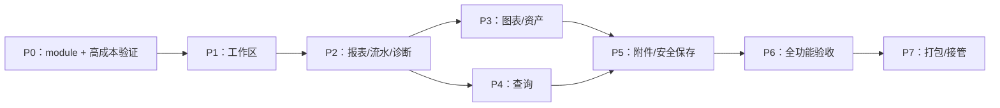

# OrangeCount MyGO Go ui 实施计划

日期：2026-10-07。状态：Go UI 迁移实现中。当前已有独立 MyGo 原生应用、每窗口工作区控制器和首批报表页面；完整迁移、验收和接管均未完成。[详细设计](mygo-native-desktop-design-2026-10-07.md)定义 R01–R15 要求，[任务台账](mygo-native-desktop-tasks-2026-10-07.md)是任务、依赖和状态的唯一来源；本文规定阶段、执行顺序、交付和 gate。

## 1. 交付原则与固定范围

先形成真实Go ui可运行骨架，并把图表、选区定位、系统面板取消和bookmark问题前置；随后按完整阅读循环迁移页面。每阶段交付可以启动、可检查的本地开发包与阶段证据，不只累计底层包或截图。旧SwiftUI应用在其新替代场景验收前保留。

迁移范围是当前macOS阅读版，不自动扩展到Web专有写账/导入/规划/透视、其他操作系统、自动更新或App Store沙盒。完整页面与系统交互见设计第6节。移植UI时继续复用当前核心实现，不回滚并行进行的兼容改进，不切换默认profile。

开发目标先macOS13编译目标/arm64；本机实际运行证据按OS如实标注。初版可交付ad hoc开发包，正式公开支持/签名/公证需要P7发行门槛。未经完整验收的中间包标明缺哪些页面与动作。

## 2. 里程碑和可检查交付

| 阶段 | 任务范围与先后 | 必须交付的产物 | 阶段退出条件 |
|---|---|---|---|
| P0 工程起点与高成本验证 | G01→G02→G03；然后G04/G05/G06/G07 | 固定module/依赖、可启动Content窗口、表格/编辑器/图表/系统交互验证页、gap/patch清单、当前SwiftUI基线 | 真正Go ui窗口可启动；中文合成+错误选区、可取消sheet、bookmark/来源编辑器和一张财务图表有可行实现与明确剩余验证；无隐含WebView回退 |
| P1 工作区完整生命周期 | G08→G09→G10/G11；G12按其依赖推进 | 可打开公开账本、显示真实快照/简单报表、双窗口、重载/关闭、持久偏好的开发包 | Open/read/reload/query取消时序及关闭释放通过；不同账本/profile不串；非法reload显示最新诊断与旧有效分析 |
| P2 报表与阅读主循环 | G13→G14/G15；再按依赖推进G16–G19 | 欢迎/报表/流水/指令/诊断可使用的包，带日期/币种/profile比较和来源动作 | cashflow、空账本、多币种、分页/展开/筛选、错误恢复和来源动作自动化+真实Go ui检查通过 |
| P3 图表与资产分析 | 先G24，再G20/G21/G22/G23 | 复用charts Module，仪表盘/账户/持仓/价格全页面 | 所有现有财务图表迁移；账务值来自核心；缺价/极值/断线和exact表一致；相应GUI与headless通过 |
| P4 查询与捕获阅读 | G25→G26→G27；G28/G29按其依赖推进 | 查询编辑/错误定位、typed结果、复合详情、预设与分析文件阅读包 | 草稿/执行/结果分离、取消、NULL/重复列、复制和输入法不误运行；所有当前捕获版本验证通过 |
| P5 附件与安全导出 | G30→G31→G32/G33；G34→G35 | 报表/查询CSV及分析文件保存、附件打开/Finder/roots、旧偏好迁移 | 固定字节保存、源/附件保护、普通bookmark恢复、policy撤销、真实filesystem失败/竞争案例通过 |
| P6 全面验收与性能 | G36→G37/G38/G39；G38→G40/G41 | 全功能候选包、R01–R15矩阵、GUI/IME/AX/性能/soak与只读私人对照摘要 | 所有适用功能无回退；实际GUI/金额/来源一致；性能与资源问题已处理，不以旧Swift或WebView结果代替 |
| P7 打包与接管 | G42→G43；公开发行走G44；满足替代覆盖后G45→G46 | 可解压的Go ui App/ZIP/SHA-256、迁移/撤回说明、正式包（条件齐备时）、入口切换和旧实现处置记录 | local dev/公开发行等级分别达标；先交付可用包再退役；完整迁移的未验环境条件清楚保留 |

每个P阶段不能仅以“所有源码已写”为退出条件。G04–G07验证代码可保留为工程harness或产品Module的起点，后续G24/G25/G35等任务负责业务完整化，不能将P0小例子直接标成相应页面完成。

## 3. 依赖与关键路径

默认执行P0→P1→P2→P3→P4→P5→P6→P7。依赖满足后，查询、图表和安全保存可以按文件职责分开推进，但不得共享未约定的WorkspaceState修改；接口变更先同步设计/测试adapter，再迁移调用方。

最可能影响工期的路径是G04编辑器公开选区→G25查询交互，G05/G06平台接口→G35迁移/面板生命周期，以及G07→G24→所有图表。优先完成这些风险所需证据，不先花时间装饰页面或做跨平台打包。

G42可在G02后建立初版CI与build脚本，最终gate在P6后集中执行。G31安全保存可以在G30完成后独立使用公开临时输入推进。G44若缺设备/证书，G43本地dev交付与已授权范围内的独立工作仍可完成，不能把dev包描述为正式签名发行。

## 4. 第一批执行步骤

| 顺序 | 操作 | 结果与记录 |
|---|---|---|
| 1 | 记录真实HEAD/dirty diff；保留上轮研究文档和用户改动；冻结公开输入shape、hash和既有macOS行为清单 | G01证据明确哪些是当前观察、哪些是历史，现有SwiftUI产物未被覆盖 |
| 2 | 建apps/goui独立module；解析固定MyGOcommit并记录pseudo-version/Origin.Hash/go.sum | G02以GOWORK=off构建；root license/module仍满足核心策略 |
| 3 | main建立Content窗口与测试身份；普通欢迎页、真实表格和ui.NewTester入口 | G03显示真实Go ui；窗口Page=nil、生产构建无cgo/C archive/Swift输入 |
| 4 | 对公开短查询/中文/emoji复现错误range定位；补选区和滚动Interface/最小fork（若必须） | G04专项patch测试，输入法组合/undo未回退 |
| 5 | 验证面板父窗口/取消、源文件外部编辑器及普通bookmark/旧偏好读取 | G05/G06记录公开接口能做什么、缺口由何处补足，禁止静默跳过原有行为 |
| 6 | 用cashflow与缺价/负值/零值fixture画折线+柱；精确表/tooltip/键盘和缩放验证 | G07证明图表实现路径，尚不标完整业务图表完成 |
| 7 | 汇总P0工程证据；修复阻断产品的gap，再进入workspace及页面实现 | 交付P0可运行包、patch manifest、剩余任务。继续Go ui方向 |

首批不应改会计引擎来适配视觉布局；发现核心缺陷时单独定义具体复现和最小修复，新的核心证据应覆盖旧受影响结果。

## 5. 工作量与职责

以下是单名开发者连续投入的初始规划区间，单位为工程日，包含相关测试/本机验收，不是完成日期。P0之后根据真实fork/平台接口成本重估；等待外部设备、证书、远端任务排队及不可预见的大范围MyGO缺陷另计。

| 阶段 | 初始区间 | 主要影响因素 |
|---|---|---|
| P0 | 3–5 | 公开选区、sheet取消和bookmark补充Interface |
| P1 | 4–6 | 并发、关闭、共享core状态及偏好隔离 |
| P2 | 4–7 | 复杂行/树、全指令与reading/profile交互 |
| P3 | 5–8 | 自绘财务图表、交互/AX及各资产页面 |
| P4 | 3–5 | typed复合值、编辑器细节和离线捕获 |
| P5 | 4–6 | 文件保护、竞争、bookmark/policy恢复 |
| P6 | 3–5 | 实际IME/AX、性能与生命周期缺陷 |
| P7 | 2–4 | 构建/许可证/安装/迁移接管 |
| 合计 | 28–46 | 由上述阶段区间相加；不按行数或测试数推导 |

职责按文件分组：workspace/engine、views/widgets/charts、platform/preferences/localfiles、build/验收。可以由同一开发者承担；如多人实施，每批明确文件所有权，共享状态和公共Interface由一个责任人协调，保留他人改动。任务台账中的职责不是自动启动多agent的授权。

## 6. 构建和测试gate

### 6.1 现有命令与待创建命令

| 类型 | 命令/入口 | 当前状态 |
|---|---|---|
| 核心 | `GOWORK=off go test -count=1 ./...`、受影响核心包race、`make fmt vet license` | 已存在；迁移期间按实际影响运行 |
| 当前语义回归 | `make parity-full query-parity query-oracle-check` | 已存在；oracle工具条件和身份沿用现有规范 |
| SwiftUI baseline | `make mac-check`、`make mac-benchmark`、`apps/macos/prepare-qa.sh` | 已存在；只在对比或core/bridge变化使旧证据失效时重跑 |
| 新桌面 | `make goui-test goui-check goui-build goui-qa` | 已创建并用于本地测试；package、benchmark、private-read、独立license target 尚未创建 |
| nested module | `cd apps/goui`后`GOWORK=off CGO_ENABLED=0 go test -count=1 ./...`及生产build | 已可执行；实际Darwin GUI与headless分开筛选 |
| race | nested module的workspace/charts测试，`CGO_ENABLED=1 go test -race ...` | workspace/app/charts/queryeditor race 已实测；与生产CGO_ENABLED=0不同 |

命令列表不是一次全部运行的要求。每任务先跑有意义的相关测试，再在阶段冻结源码后集中跑required gate；同一输入/源码/工具链下已经有效的检查不反复刷新。只改文档时验证链接、ID/依赖/范围一致性，不运行产品全量测试冒充新增证据。

### 6.2 分阶段测试强度

| 阶段 | 必需自动化与实际行为 |
|---|---|
| P0 | module/core引用、无cgo生产build、真实Content窗口、table/editor/chart headless，平台gap专项实测 |
| P1 | workspace可控时序、真实Session加载/重载/关闭、相关race、双窗口actual check |
| P2–P4 | 页面真实core输入+ui headless、相应GUI流程、typed精确值/身份；受影响core才扩展核心gate |
| P5 | 真实文件保存/失败/竞争与roots/policy测试、相关race、真实面板/Finder/bookmark |
| P6 | 新desktop全量+race、冻结core全量/差分、全页面GUI+真人IME/AX、性能/soak、private只读新UI链路 |
| P7 | prodbuild/包许可证/signature/Mach-O、临时目录解压启动、两应用偏好隔离/迁移/回退、发行等级相应外部验收 |

只读私人账本对照不修改源文件、不提交正文/账户/金额/私人路径/截图；新private-read探针需经过新workspace/Go ui实际状态，不能只跑旧Swift/C而标Go ui通过。必要账务等价对照仍使用现有脱敏摘要纪律。

## 7. 阶段证据与任务完成规则

每阶段保存`docs/evidence/goui-pN-YYYY-MM-DD.md`，至少包含：core/desktop/MyGO/fork修订、dirty输入、机器/OS/工具链、输入hash/shape、实际命令及exit、GUI明确操作/预期/实际、性能统计范围、已知缺口及产物SHA-256。

任务状态只有五类：未开始、进行中、已实现待验证、已验证、外部条件未具备。标“已验证”须满足该任务验收且没有已知实质问题；整个阶段退出还需其整体gate。计划存在、文件存在、test exit0、GUI通过和安装/发行是不同层级，不能相互替代。

实施中新增任务给新ID，不改旧ID的含义；变更范围同步设计、任务台账和ADR（若路线/重要取舍改变）。如果P0实际成本超出估计，更新工程日区间与原因，不偷偷删除功能或降低门槛。

## 8. 主版本接管与撤回

1. G43先交付完整开发包和限制；本机用户可以使用Go ui，旧包保持可打开。正式支持范围依实际验收声明。
2. G45建立旧测试→新测试/新GUI场景映射，保留尚无替代的bridge/tools。切换前冻结一次最终源码、完成适用R01–R15门槛。
3. G46切换默认macOS开发入口/文档/稳定身份与偏好迁移，产出实际可安装包和撤回步骤；旧实现可保留独立legacy标签/产物，删除清单逐项有替代证据。
4. 正式公开包需要G44的目标系统/另一机器/Developer ID/公证证据。外部条件未齐时只交付明确标识的development等级，不宣称整个公开发行完成。

若接管后出现金额、快照串用、数据保存、输入法或启动阻断，撤回默认入口到保留的SwiftUI版本，保存新偏好备份与公开复現证据，再修复Go ui问题。撤回只影响应用入口/偏好，不改源账本或核心语义配置。

## 9. 当前实施状态与下一步

Go UI 迁移已经开工，当前仍是开发预览，不能替代旧 SwiftUI 客户端。任务台账与阶段证据记录每次实际实现和验证；前期“下一次授权后从 G01 开始”的规划描述已失效。工作区控制器与首批报表已建立，读取队列按规范化 Request、snapshot 和 revision 校验，日期/币种/估值筛选已连到核心请求，诊断页能显示消息、位置与 Finder 来源动作；隔离的版本化 JSON 偏好已接入账本打开与筛选保存，欢迎页有明确选择才打开的最近账本，旧 defaults allowlist reader 和迁移 marker 已接入，并迁移旧附件 roots 的普通 bookmark/generation。账本偏好现在会恢复列顺序/列宽，动态查询结果按 typed schema 摘要隔离；新增按账本保存的诊断语言选择，让核心投影生成中文或英文诊断，但全界面 en/zh-CN 文案仍待 G36 完成；旧生产域内容的实机验收仍待完成；偏好备份导出已实现并通过原生面板/安全写入验收，完整产品首次启动恢复仍待 G43 验收。证据见[G12诊断语言记录](evidence/goui-p1-g12-diagnostic-locale-2026-10-07.md)和[G12偏好备份导出记录](evidence/goui-p1-g12-backup-2026-10-08.md)。Darwin ordinary NSURL bookmark adapter 已实现创建、无 UI/不挂载解析和 stale/canonical/device/inode 校验；roots 管理、启动恢复、Session policy 和同进程窗口撤销同步已经接入并有 headless/race 测试；真实多窗口 UI 撤销仍待验。新账本默认 profile 保持旧客户端的 `legacy`。G11 的每窗口查询 runner和报表捕获直接取消路径已通过 headless/race 验收；G14 已有 counts-only 语义预览、按原始输入身份保护的 profile 应用和成功后偏好保存初版，自动化证据见[G14记录](evidence/goui-p2-g14-2026-10-07.md)，真实GUI及公开 AVERAGE 验收仍待完成。G15 的财务报表已经接入 `OutlineTable` 账户层级、稳定全名身份、多币种列和全展开/折叠初版，自动化证据见[G15记录](evidence/goui-p2-g15-2026-10-07.md)，通用精确值控件、typed 排序和真实辅助功能验收仍待完成。G18 已有 all/config 指令页初版，支持筛选、分页、类型化元数据与生成来源，headless fixture 证据见[P2记录](evidence/goui-p2-2026-10-07.md)，实机/辅助功能验收仍待完成。G25/G26 已有 TextArea、错误选区、显式按钮/Cmd+Enter、快照上下文和 typed Table 查询工作台初版，完整复合结果的后续增强、真人输入法和实机查询 GUI 验收仍待完成；查询目录首轮已实现，当前仍需真实 GUI 验收。附件页现在显示 document 声明状态，打开/Finder 动作经 Session 重验证；实机 Shell 行为仍待验收。P1 仍需完成真实 GUI 故障矩阵、筛选快速切换和交互 soak。P0 的来源编辑器动作与图表交互缺口仍在收尾。后续继续推进 profile/报表/持仓/价格、导出、可访问性、全量等价验收、打包和默认入口接管；实现状态以[任务台账](mygo-native-desktop-tasks-2026-10-07.md)、[P1证据](evidence/goui-p1-2026-10-07.md)、[P2指令阅读证据](evidence/goui-p2-2026-10-07.md)、[G14语义配置证据](evidence/goui-p2-g14-2026-10-07.md)、[G15账户树证据](evidence/goui-p2-g15-2026-10-07.md)及[P4查询工作台证据](evidence/goui-p4-2026-10-07.md)为准。

G16 的报表页面已增加仅筛选可见树行的账户搜索，保留核心父级 `SubtreeAmounts` 和完整投影币种列；headless 验证见[G16记录](evidence/goui-p2-g16-2026-10-07.md)。多币种缺价/empty矩阵、导出联动和实际 GUI 操作仍未验收。
